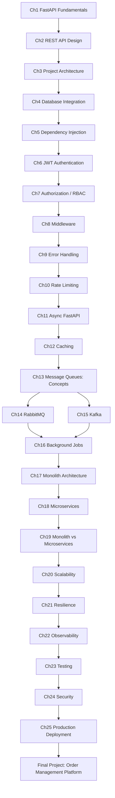

# Roadmap

## Dependency graph

## Why this order

- **1-3 (Fundamentals → REST → Architecture)**: you need a mental model of a request's full journey and
  a defensible project layout before anything else makes sense. Skipping straight to auth or queues on
  top of a messy `main.py` teaches bad habits that compound.
- **4-5 (Database → DI)**: DI is taught right after the database because `get_db()` is the dependency
  that makes everything downstream (auth, services, tests) composable.
- **6-9 (Auth → Authz → Middleware → Errors)**: these four are the "cross-cutting concerns" cluster —
  each one wraps around every request, so they're taught together.
- **10-12 (Rate limiting → Async → Caching)**: all three are about *protecting and speeding up* a
  single service before we introduce other services.
- **13-16 (Queues)**: once one service is solid, we introduce talking to *other* things asynchronously.
- **17-19 (Monolith → Microservices → Comparison)**: architecture decisions only make sense once you've
  felt the pain a modular monolith solves and the pain it eventually creates.
- **20-22 (Scale → Resilience → Observability)**: you cannot scale or harden a system you can't observe,
  so observability is deliberately taught last in that trio, once you know what's worth measuring.
- **23-25 (Testing → Security → Deployment)**: production readiness, done last on purpose — security and
  deployment decisions are much clearer once you've built and broken the system yourself.

## Suggested pace

| Weeks | Chapters | Milestone |
|-------|----------|-----------|
| 1 | 1-3 | Working CRUD API with a clean layered structure |
| 2 | 4-7 | Postgres-backed API with JWT auth + RBAC |
| 3 | 8-12 | Production-grade single service: middleware, errors, rate limits, caching |
| 4 | 13-16 | Same service now emits and consumes events |
| 5 | 17-19 | Can argue monolith-vs-microservices with real trade-offs, not slogans |
| 6 | 20-22 | Can explain how the system scales and what happens when a dependency dies |
| 7 | 23-25 | Tested, secured, deployable |
| 8 | Final project | Evolve one system through 6 real architecture versions |
