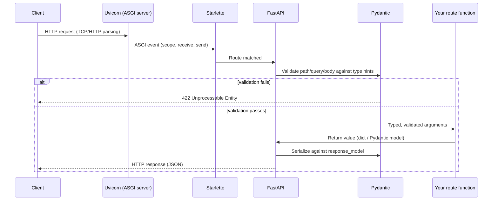

# Chapter 1 — FastAPI Fundamentals

## Concept

FastAPI is a Python web framework for building APIs, built on **Starlette** (the actual ASGI toolkit
that handles requests/responses/routing) and **Pydantic** (data validation). FastAPI itself mostly adds:
declarative routing, automatic request validation from type hints, dependency injection, and automatic
OpenAPI/Swagger docs generation.

## Why it exists

Before ASGI frameworks, Python web servers were built on **WSGI**, a synchronous interface: one thread
handled one request at a time, blocked on I/O. That's fine for CPU-light, I/O-light apps, but it wastes
threads whenever a request is waiting on a database call, an HTTP call to another service, etc.
**ASGI** (Asynchronous Server Gateway Interface) lets a single process handle many concurrent requests
by switching to other work while one request is waiting on I/O. FastAPI was built specifically to make
async-first APIs as ergonomic as Flask made sync ones.

## Mental model

Think of FastAPI as a **thin declarative layer over three things**:
1. **Routing** — "if this path + method arrives, call this function"
2. **Validation** — "here's the shape of the input/output, reject it if the shape doesn't match"
3. **Injection** — "here's what this function needs to run" (covered fully in chapter 5)

## Architecture diagram — the request lifecycle



Concretely: **Uvicorn** is the ASGI server (it terminates the TCP connection, understands HTTP)."
**ASGI** is just the calling convention between Uvicorn and your app. **FastAPI/Starlette** is the
app that ASGI convention invokes.

## Minimal example

```python
from fastapi import FastAPI

app = FastAPI()

@app.get("/ping")
def ping():
    return {"message": "pong"}
```

That's a complete, runnable API. `uvicorn main:app --reload` and hit `/ping`.

## Realistic example

See `app/main.py` in this folder — a full CRUD API over a `Product` resource covering:
- Path parameters with validation (`Path(..., gt=0)`)
- Query parameters with defaults, bounds, and enums (`Query(...)`, filtering, pagination)
- Request bodies via Pydantic models, including a **separate create model vs update model** — this
  matters: your "create" shape and "update" shape are rarely identical (updates are usually partial).
- `response_model` to control exactly what's serialized back, decoupled from what you store internally
- Correct status codes per verb (201 for POST, 204 for DELETE, 404 for missing resources)
- Custom headers (`Location` on create) and cookies (`Set-Cookie` on `/whoami`)
- A bulk endpoint taking a JSON array body

Run it:
```bash
cd chapter1/app
uvicorn main:app --reload --port 8000
```
Then open `http://localhost:8000/docs` — Swagger UI is generated entirely from your type hints and
docstrings, for free. `/redoc` gives you the same spec in a different (read-only, prettier) viewer.

## Common mistakes

- **Returning a dict when you declared a `response_model`.** FastAPI will still try to coerce it, but
  you lose type safety on the way in. Return the actual Pydantic model or `.model_dump()`'d dict that
  matches its shape.
- **Using GET with a request body.** Some clients and proxies silently drop GET bodies. If you need
  complex "search" semantics, use POST to a `/search` sub-resource instead, or keep it to query params.
- **One model doing double duty for create, update, and output.** You'll eventually need to hide a
  field on output (e.g. a password hash) or make a field optional only on update. Split the models
  early — it's a five-minute cost now vs a schema migration headache later.
- **Forgetting `exclude_unset=True` on PATCH.** Without it, every field in your update model —
  including the ones the client didn't send — get treated as explicit `None` values and will overwrite
  existing data.

## Production considerations

- **`--reload` is a dev-only flag.** It watches the filesystem and restarts workers on every save —
  meaningful overhead you never want in production (chapter 25 covers Gunicorn + Uvicorn workers).
- **OpenAPI docs are public by default.** In production, decide deliberately whether `/docs` and
  `/redoc` should be exposed, gated behind auth, or disabled (`docs_url=None`).
- **Validation errors leak schema details.** A 422 response includes your field names and constraints.
  That's usually fine, but for security-sensitive fields, consider what a 422 body reveals to an
  unauthenticated caller.

## Exercise

Extend `app/main.py` with an `Order` resource:
- `POST /orders` takes a `product_id` and `quantity`, looks up the product, rejects (400) if the
  product doesn't exist or `in_stock` is false.
- `GET /orders/{id}` returns the order with the product's current name and price embedded (not just
  the `product_id`) — this is your first taste of a **response shape that isn't a 1:1 mirror of storage**.
- Add query-param filtering to `GET /orders` by a `min_total_cents` value.

## Interview-style scenario

> "A teammate's PR adds a new field to `ProductCreate` as required, no default. What breaks, for whom,
> and when — in a Swagger client that's cached the old schema? In a mobile app that shipped with the
> old schema six months ago and can't be force-updated? How would you have introduced the field
> instead?"

Think about backward compatibility, and revisit this after chapter 2 (versioning) and chapter 19
(operational complexity of changing an API contract that other teams depend on).
