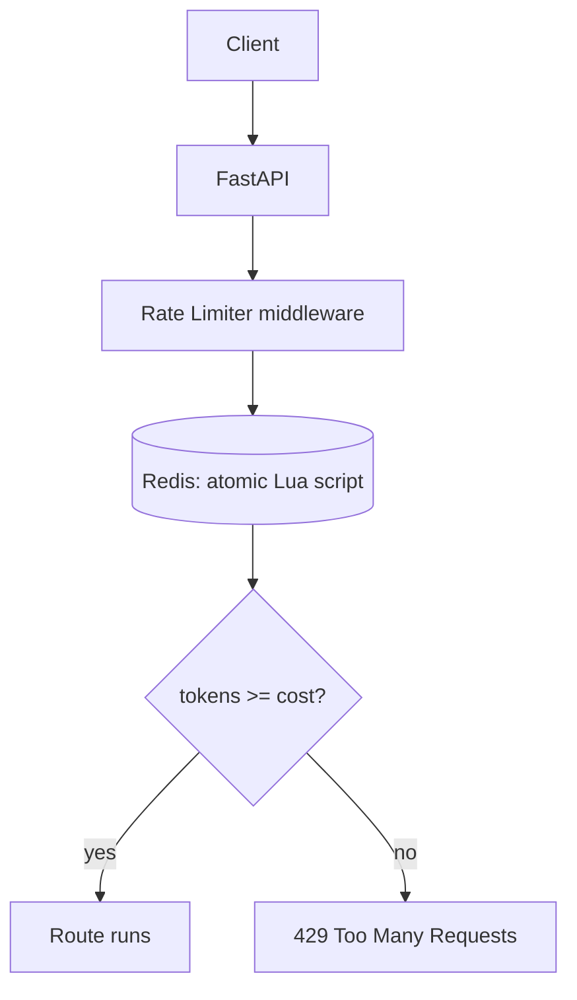

# Chapter 10 — Rate Limiting

## Concept

Rate limiting caps how many requests a client (by IP, user, API key, etc.) can make in a given window,
protecting your service from abuse, runaway clients, and traffic spikes it can't handle.

## Why it exists

Without limits, one misbehaving script, a retry storm, or a scraper can consume enough capacity to
degrade service for everyone else. Rate limiting is cheap insurance against the most common form of
self-inflicted (or malicious) overload.

## Algorithms

| Algorithm | How it works | Weakness |
|---|---|---|
| Fixed window | Count requests in each fixed time slice (e.g. per minute) | Burst at window boundary: 2x the limit possible across the boundary |
| Sliding window | Weighted count across the current + previous window | More accurate, more state to track |
| **Token bucket** | Bucket refills at a steady rate, request costs tokens | Allows controlled bursts up to bucket capacity — used here |
| Leaky bucket | Requests queue and drain at a fixed rate | Smooths bursts into a steady rate, adds latency |

This chapter implements **token bucket**: it allows a burst up to `capacity`, then settles to a steady
`refill_rate` requests/second — a good default because real traffic is bursty, not perfectly uniform.

## Mental model

```
tokens = min(capacity, tokens + elapsed_seconds * refill_rate)
if tokens >= cost: tokens -= cost; ALLOW
else: REJECT (429)
```

## Diagram



## Why Redis, and why a Lua script

A single app instance could track buckets in memory, but that only limits traffic to *that instance* —
with 5 instances behind a load balancer, the real limit becomes 5x what you intended. Redis gives every
instance a shared view of the bucket state.

The check-then-update sequence (read tokens, compute new value, write it back) is a classic
**race condition** if done as separate Redis commands: two concurrent requests could both read "1 token
left," both decide to allow, and both proceed — exceeding the limit. `TOKEN_BUCKET_LUA` in
`app/rate_limiter.py` runs the whole sequence as one atomic operation on the Redis server, which
processes commands (and Lua scripts) single-threaded — no race is possible.

## Realistic example

`app/rate_limiter.py`'s `TokenBucketRateLimiter` is used as HTTP middleware in `app/main.py`, keyed by
client IP, returning `429` with a `Retry-After` header when exhausted, and echoing remaining tokens via
`X-RateLimit-Remaining` on success.

Because this needs Redis at request time, the **tests** (`app/tests/test_rate_limiter.py`) run against
`fakeredis` instead — same Lua script, no real Redis process needed, so `pytest` runs instantly and
without infrastructure:
```bash
cd chapter10
PYTHONPATH=. pytest app/tests -v          # runs against fakeredis
docker compose up -d redis                 # for running the real app
PYTHONPATH=. uvicorn app.main:app --reload --port 8000
for i in {1..8}; do curl -s -o /dev/null -w "%{http_code}\n" localhost:8000/ping; done
# expect: 200 x5 (burst capacity), then 429s until tokens refill
```

## Common mistakes

- Limiting by IP alone behind a shared corporate NAT or a mobile carrier's CGNAT — hundreds of real
  users can share one IP, and a per-IP limit punishes all of them for one bad actor.
- Not returning `Retry-After` — well-behaved clients back off blindly (or immediately retry) without it.
- Applying the same limit to every endpoint — a login endpoint (brute-force target) and a health check
  endpoint have very different appropriate limits.
- Forgetting the atomicity problem and implementing check-then-set as two separate Redis calls.

## Production considerations

- Layer limits: a coarse per-IP limit at the edge (API gateway/CDN) plus a finer per-user or per-API-key
  limit inside the app — different granularities catch different abuse patterns.
- Rate limit **by cost**, not just by count, for endpoints with wildly different expense (a bulk export
  endpoint might cost 20 "tokens" vs 1 for a simple read).
- Make limits observable: log/metric every 429 with the key that triggered it, so you can tell abuse
  from a misconfigured limit before your support queue tells you.

## Exercise

Add a second limiter tier: a stricter limit specifically on `POST /auth/login` (tie this chapter to
chapter 6), keyed by the *submitted username*, not IP — so an attacker can't dodge the limit by
rotating IPs against one target account.

## Interview-style scenario

> "Your rate limiter is per-IP, capacity 100/minute. After a mobile carrier's IP pool starts getting
> flagged, several legitimate users report being blocked while making far fewer than 100 requests each.
> What's happening, and what are two different ways to fix it without simply raising the limit?"
