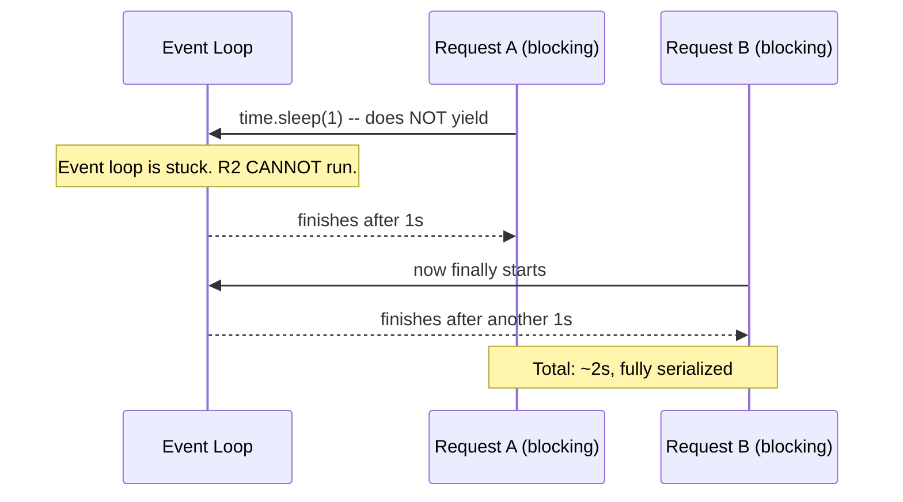
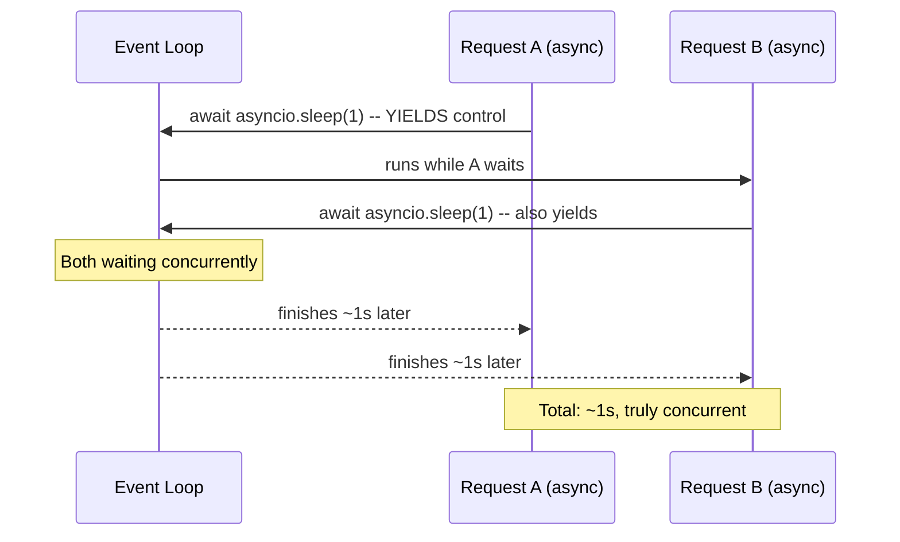

# Chapter 11 — Async FastAPI

## Concept

`async`/`await` let a single-threaded event loop handle many concurrent requests by switching to other
work whenever the current one is waiting on I/O (network, disk, timers) — instead of one thread blocking
per request.

## Why it exists

I/O-bound workloads (which most APIs are — waiting on a database, another service, a cache) spend most
of their time waiting, not computing. Async lets that waiting time be shared: while request A waits on a
DB, the event loop serves request B, C, D. This is the entire performance case for FastAPI over a
classic sync WSGI framework.

## Mental model — the trap this chapter exists to teach

**`async def` does not make blocking code non-blocking.** It only means "this function *may* yield
control back to the event loop at `await` points." If nothing inside it ever `await`s anything (it just
calls `time.sleep()`, or a sync DB driver, or does heavy CPU work), it blocks the *entire* event loop —
every other concurrent request on that worker process — for as long as it runs.

## Diagram





## Demonstrated, not just described

`app/tests/test_async.py` fires two concurrent requests at `/blocking-in-async` and separately at
`/actually-async`, and asserts on the **wall-clock time**:

```python
# blocking: ~2s for two 1s calls concurrently -- the event loop was stuck
assert elapsed > 1.8

# async: ~1s for two 1s calls concurrently -- true concurrency
assert elapsed < 1.5
```

Run `PYTHONPATH=. pytest app/tests -v` yourself and watch it pass — this isn't a claim, it's measured.

## def vs async def

| | `def` route | `async def` route |
|---|---|---|
| Where it runs | FastAPI's thread pool | The event loop, directly |
| Blocking call inside? | Fine — it's already isolated in its own thread | Blocks EVERYONE on that worker |
| Best for | Sync libraries with no async equivalent | Native async libraries (asyncpg, httpx, aioredis) |

`app/main.py`'s `blocking_fixed_with_threadpool` shows the fix when you're stuck with a sync library:
just don't mark the route `async def` — FastAPI runs plain `def` routes in a thread pool automatically.

## Concurrent API aggregation

```python
responses = await asyncio.gather(*(client.get(u) for u in urls))
```

`asyncio.gather` runs all the awaitables concurrently and waits for all of them — 3 independent 200ms
calls finish in ~200ms total instead of ~600ms sequential. See `/aggregate` in `app/main.py`.

## Common mistakes

- Using a sync DB driver (`psycopg2`) or sync HTTP client (`requests`) inside an `async def` route —
  looks fine in dev with one user, silently serializes your whole service under real concurrent load.
- Doing CPU-heavy work (image processing, heavy computation) inside `async def` — CPU work never yields
  to the event loop either; it needs a process pool (`run_in_executor` with a `ProcessPoolExecutor`), not
  just "being async."
- Mixing sync and async DB sessions in the same codebase without realizing which endpoints are
  vulnerable to the blocking trap.

## Production considerations

- Load test with *concurrent* requests, not just sequential ones — a blocking bug is invisible in a
  single-request benchmark and only shows up under concurrency, exactly like the test above.
- If you must call a sync library from an async route, wrap it explicitly: `await
  run_in_executor(None, sync_function)` — don't just call it directly and hope.

## Exercise

Add `/mixed` which calls one truly-async operation (`asyncio.sleep`) and one CPU-bound operation
(compute a large Fibonacci number synchronously) in the same request. Predict, then measure, how it
behaves under 5 concurrent requests, and explain why `asyncio.gather` doesn't help with the CPU-bound
half.

## Interview-style scenario

> "Your team migrates a Flask app to FastAPI, marking every route `async def` without changing the
> underlying `psycopg2` DB calls, expecting a free performance win. Load testing shows P99 latency got
> *worse* under concurrent load. Explain why, precisely."
