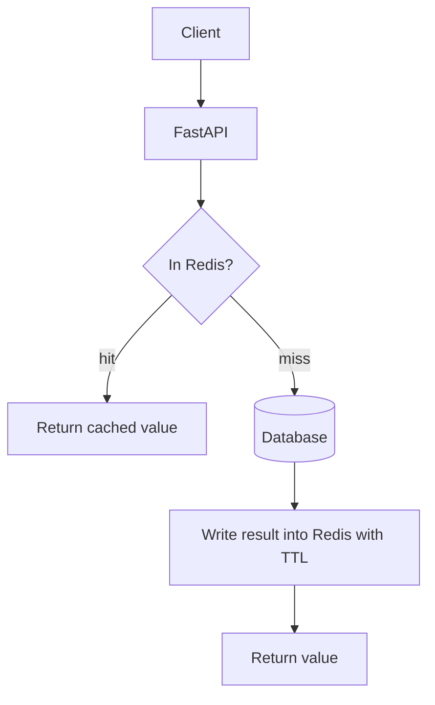

# Chapter 12 — Caching

## Concept

Caching stores a copy of expensive-to-compute or expensive-to-fetch data somewhere faster (usually
in-memory, via Redis) so subsequent requests skip the expensive path.

## Why it exists

A database read might take 5-50ms; a Redis read of the same data takes under 1ms. For read-heavy
endpoints (product pages, user profiles, anything read far more often than it changes), caching is
often the single highest-leverage performance change available.

## Mental model

- **Cache hit**: data found in cache, expensive path skipped.
- **Cache miss**: not found, fall through to the real source, then populate the cache for next time.
- **TTL (time to live)**: how long an entry survives before it expires automatically, bounding
  staleness even if you forget to explicitly invalidate it.

## Diagram



## Caching strategies

- **Cache-aside** (used here): application code checks the cache, and on a miss, reads the source and
  populates the cache itself. Simple, explicit, most common pattern.
- **Read-through**: the cache layer itself knows how to fetch on a miss — the app never sees a miss.
  Needs a caching layer/library that supports this; more setup, less app code.
- **Write-through**: every write goes through the cache, which writes to the DB and updates itself
  atomically. Keeps cache always fresh, at the cost of write latency.

## Realistic example

`app/cache.py`'s `ProductCache` implements cache-aside explicitly. `app/main.py` wires it into a
Products API: `GET /products/{id}` checks cache first; `PUT`/`DELETE` invalidate (delete, not update)
the cache entry after writing to the source of truth.

`app/tests/test_cache.py` proves this isn't just plausible-looking code — it patches in `fakeredis`,
tracks a `DB_CALL_COUNT`, and asserts the database is hit **exactly once** across two reads of the same
product (the second is served from cache), and that a write makes the *next* read hit the database again
(proving invalidation actually happened, not just that the code compiles).

```bash
cd chapter12
PYTHONPATH=. pytest app/tests -v
docker compose up -d redis
PYTHONPATH=. uvicorn app.main:app --reload --port 8000
curl localhost:8000/products/1   # "source": "database"
curl localhost:8000/products/1   # "source": "cache"
```

## Consistency trade-offs

Caching always trades some staleness for speed. Even with immediate invalidation on write, there's a
brief window between "DB write committed" and "cache entry deleted" where a concurrent read could still
see stale data. For most product/content data this is an acceptable trade-off; for financial balances
or inventory counts at checkout, it usually isn't — read those from the source of truth, or use a much
shorter TTL, or don't cache them at all.

## Cache stampede, penetration, avalanche

| Problem | What happens | Mitigation |
|---|---|---|
| **Stampede** | A hot key expires; many concurrent requests all miss simultaneously and all hammer the DB at once | Lock/single-flight the recompute, or refresh proactively before expiry |
| **Penetration** | Requests for keys that don't exist in the DB either — cache never helps, DB gets hit every time | Cache the "not found" result too (with a short TTL) |
| **Avalanche** | Many keys expire at the same moment (e.g. all set with the same TTL at the same time) | Add jitter to TTLs (`ex=300 + random.randint(0, 30)`) |

## Common mistakes

- Overwriting the cache entry on write instead of deleting it — if the write itself fails partway, you
  can end up with a cache entry that doesn't match the DB at all, worse than just being briefly missing.
- No TTL — an entry with no expiry lives forever if invalidation logic ever has a bug, silently serving
  stale data indefinitely instead of eventually self-correcting.
- Caching per-user data under a shared key — a classic and serious bug: `cache:profile` shared across
  users instead of `cache:profile:{user_id}` leaks one user's data to another.

## Production considerations

- Monitor your cache hit rate — a caching layer that's mostly missing isn't earning its complexity cost
  and might indicate a key-design bug or a TTL that's too short for your access pattern.
- Decide invalidation ownership clearly: if multiple services can write the same entity, every one of
  them needs to know to invalidate the same cache key, or you'll get silent staleness only some writers
  fix.

## Exercise

Add caching to a `GET /products` list endpoint, but with a shorter TTL than individual products (lists
change more often as items are added/removed). Then make any `POST /products` also invalidate the list
cache key specifically — a bare `cache.invalidate(product_id)` from this chapter's pattern won't cover it,
since there's no single `product_id` for a list.

## Interview-style scenario

> "Your `/products/{id}` cache has a 5-minute TTL. A price change needs to be visible to ALL clients
> within 2 seconds of the update, but a straightforward TTL-only approach can't guarantee that. What two
> different approaches would you consider, and what does each cost you?"
