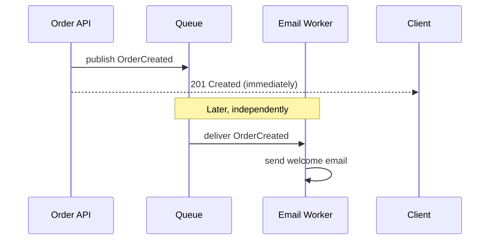

# Chapter 13 — Message Queues: Concepts

## Concept

A message queue lets one part of a system (a **producer**) hand off work to another part (a
**consumer**) without either waiting on the other directly — decoupling *when* work happens from *when*
it was requested.

## Why it exists

Not every consequence of a request needs to happen before you respond to the caller. "Order was
created" should return quickly; "send a welcome email," "update analytics," "notify the warehouse" can
all happen slightly later, off the request's critical path. Chaining all of them synchronously means
your API's latency and uptime become the *minimum* of every downstream dependency's latency and uptime.

## Mental model

```
Synchronous:  Service A ---waits---> Service B ---waits---> Response
Asynchronous: Service A -> Message Queue -> (later, independently) -> Service B
```

## Diagram



## Demonstrated, not just described

`app/sync_vs_async.py` implements both versions with a simulated slow email dependency. Running it:

```
sync create_order took 0.3 s (includes email latency)
async create_order took 0.0 s (email latency deferred)
```

The synchronous version's request latency is *coupled* to the email service's latency. The asynchronous
version's is not — and if the email service is entirely down, `AsynchronousOrderService.create_order`
still succeeds; the message just waits in the queue until a consumer can process it.

## Core vocabulary

| Term | Meaning |
|---|---|
| Queue | Ordered (or not) buffer of pending messages |
| Producer | Code that publishes a message |
| Consumer | Code that receives and processes a message |
| Message | The unit of data being passed (usually JSON) |
| Broker | The middleman service managing queues (RabbitMQ, Kafka) |
| Topic | A named stream of related messages (Kafka terminology) |
| Partition | A topic split into ordered sub-streams for parallelism (Kafka) |
| Offset | A consumer's position within a partition (Kafka) |
| Acknowledgement (ack) | Consumer's signal "I successfully processed this" — lets the broker safely remove/advance past it |
| Retry | Re-attempting a message that failed processing |
| Dead-letter queue | Where messages go after repeated failed processing, for later inspection |

## What you gain, and what you give up

**Gain:** independent scaling (add more consumers under load without touching producers), fault
isolation (a downstream outage doesn't cascade back to callers), and natural buffering (a burst of
requests becomes a burst of queued messages, processed at a sustainable rate, instead of an overload).

**Give up:** immediate consistency (the email genuinely hasn't been sent yet when the API responds —
some UIs need to account for this, e.g. "your order is confirmed, a receipt will arrive shortly" instead
of implying it already has), and operational complexity (a broker is another moving part that can fail,
need monitoring, and need capacity planning).

## Common mistakes

- Reaching for a queue for everything, including things that genuinely need to happen before responding
  (e.g. "was there actually enough stock to fulfill this order?" belongs in the synchronous path).
- Treating "published to the queue" as equivalent to "guaranteed delivered and processed" — without
  acks, retries, and dead-letter handling (chapters 14-15), a message can be silently lost.
- No idempotency on the consumer side — most brokers guarantee **at-least-once** delivery, meaning a
  consumer must tolerate processing the same message twice without bad side effects (e.g. sending the
  welcome email twice).

## Production considerations

- Decide per-operation: does this *have* to complete before the caller gets a response, or can it happen
  "eventually, reliably"? That's the line between synchronous logic and a published event.
- Plan for consumer failure from day one — what happens to a message if the consumer crashes mid-
  processing? (Chapters 14-15 cover ack semantics and dead-letter queues concretely.)

## Exercise

List five operations in a typical e-commerce checkout flow (charge payment, reserve inventory, send
confirmation email, notify the warehouse, update a recommendation model). For each, decide: synchronous
or event-driven — and justify the choice in one sentence per operation.

## Interview-style scenario

> "Your team wants to move 'charge the customer's card' from the synchronous checkout path to a
> background queue, to make checkout feel faster. What could go wrong with that specific choice, and why
> is 'reserve inventory' probably a better candidate to move to a queue first?"
