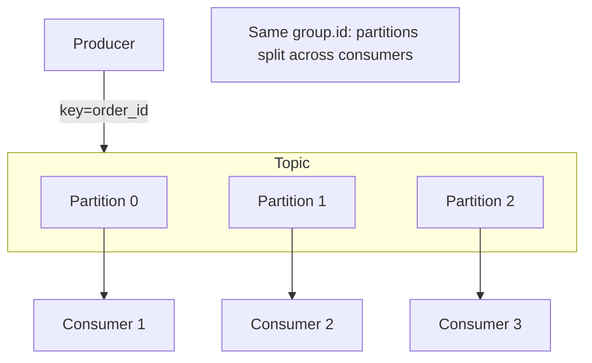

# Chapter 15 — Kafka

## Concept

Kafka is a distributed, append-only log. Producers write records to **topics**; topics are split into
**partitions** for parallelism; **consumer groups** read from those partitions, tracking their position
via an **offset**.

## Why it exists

Kafka's design goal is different from RabbitMQ's. RabbitMQ optimizes for "deliver this task to exactly
one worker, then it's gone." Kafka optimizes for "durably retain a stream of events that many different,
independent consumers can each read at their own pace, and even replay from the beginning." Think:
"what happened" (Kafka: an immutable event log) vs "please do this" (RabbitMQ: a work queue).

## Do NOT say "Kafka = big RabbitMQ"

They solve different problems:
- **RabbitMQ**: once a message is consumed and acked, it's gone. Great for distributing discrete tasks.
- **Kafka**: messages stay in the log for a configured retention period (hours to forever), regardless
  of how many consumer groups have read them. A brand-new consumer group can replay the entire history.
  Great for event sourcing, analytics pipelines, and multiple independent teams consuming the same
  stream of "things that happened" for different purposes.

## Mental model

```
Producer -> Topic (split into Partitions) -> each partition read by one consumer in a group
```

Ordering is guaranteed **only within a partition**, not across the whole topic. This is why the message
**key** matters — Kafka routes messages with the same key to the same partition deterministically, so
"all events for order #42" stay strictly ordered relative to each other, even with many partitions
overall.

## Diagram



## Setup

```bash
docker compose up -d zookeeper kafka
```

## Realistic example

`app/producer.py` publishes to an `orders` topic, keyed by `order_id`. `app/consumer.py` joins consumer
group `order-email-service`, with **manual offset commits** — the offset is only advanced after
successful processing, so a crash mid-processing means the message is redelivered on restart.

```bash
cd chapter15
PYTHONPATH=. python app/consumer.py &
PYTHONPATH=. python app/producer.py
```

Run a second `consumer.py` with the **same** `group.id`: Kafka splits the topic's partitions between
them automatically — this is how you scale Kafka consumers horizontally, no code changes needed.

## Broker, replication, ordering, retention

- **Broker**: one Kafka server; a cluster has several, for both throughput and fault tolerance.
- **Replication**: each partition is copied across multiple brokers, so losing one broker doesn't lose
  data — a production concern this chapter's single-broker `docker-compose.yml` doesn't demonstrate, but
  is the whole point of running Kafka in a cluster.
- **Ordering**: guaranteed per-partition, not per-topic. Design your partition key around what you need
  ordered relative to what else.
- **Retention**: configurable per topic — Kafka doesn't delete a message just because it's been
  consumed; it deletes based on time or size limits, independent of consumption.

## Common mistakes

- Using a random/missing key when message ordering actually matters — messages for the same logical
  entity can land on different partitions and be processed out of order relative to each other.
- `enable.auto.commit: True` (the default) for work where you need at-least-once semantics with
  idempotent processing guarantees — auto-commit can advance the offset before processing actually
  finishes, silently *losing* a message on a crash (weaker than at-least-once in practice).
- Assuming Kafka "deletes messages once consumed" like RabbitMQ — it doesn't; plan retention and disk
  usage deliberately.

## Production considerations

- Partition count is a scaling ceiling: you can have at most as many active consumers *in one group* as
  there are partitions — plan partition count for your expected peak consumer parallelism, since
  increasing it later doesn't retroactively fix ordering guarantees for already-written data.
- Consumer processing must be idempotent — Kafka's default delivery guarantee (without careful
  transactional configuration) is at-least-once, meaning your consumer *will* see some messages twice
  eventually (rebalances, crashes, retries).

## Exercise

Publish `OrderCreated`, `OrderShipped`, and `OrderCancelled` events all to the same `orders` topic, keyed
by `order_id`. Write a consumer that reconstructs an order's current status purely by replaying its
event history from the beginning — this is the core idea behind event sourcing.

## Interview-style scenario

> "Your `orders` topic has 6 partitions. Your consumer group currently runs 3 instances. You scale to 8
> instances to handle load. What happens to the 2 'extra' instances, and why does adding more consumers
> than partitions not help throughput?"
