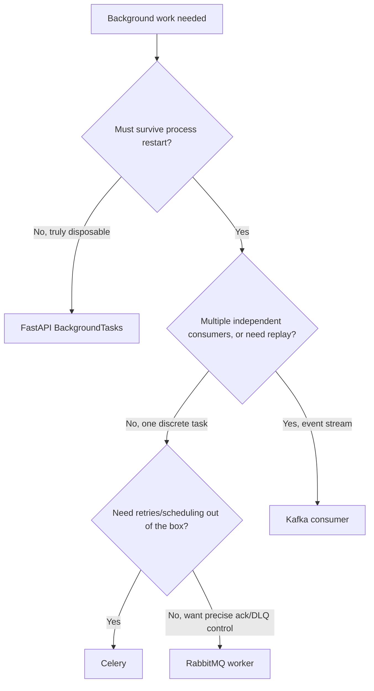

# Chapter 16 — Background Jobs

## Concept

Four different tools for "do this work outside the request/response cycle," each with different
durability, scaling, and complexity trade-offs: FastAPI's `BackgroundTasks`, Celery, a RabbitMQ worker
(chapter 14), and a Kafka consumer (chapter 15).

## Why it exists

Chapter 13 established *when* to defer work off the request path. This chapter answers *which tool*,
given four genuinely different options with different guarantees — picking the wrong one either adds
unneeded operational complexity or silently loses work you needed to keep.

## The full comparison

See `docs/decision-table.md` for the complete table. The one-line versions:

- **`BackgroundTasks`**: runs after the response, same process, zero infra, **not durable**.
- **Celery**: a real task queue with a broker, workers, retries, durability — the most common "just give
  me reliable background jobs" answer in the Python ecosystem.
- **RabbitMQ worker**: you own the ack/retry/DLQ logic explicitly (chapter 14) — more control, more code.
- **Kafka consumer**: for event streams multiple consumers care about, not single discrete tasks
  (chapter 15).

## Diagram

## Realistic example

`app/background_tasks_demo.py` is a working, tested `BackgroundTasks` example: the response returns to
the client immediately, and `send_welcome_email` runs after. `app/tests/test_background.py` confirms it
actually ran (note the docstring caveat: `TestClient` runs background tasks synchronously in tests, which
is convenient but not identical to production timing).

`app/celery_example.py` shows the shape of a Celery task with automatic retry — `self.retry(exc=exc)`
inside an `except` block, configured with `max_retries` and a retry delay. Unlike `BackgroundTasks`, this
task is durable: if the API process restarts the instant after `.delay()` is called, the task is already
safely in Redis/RabbitMQ (the Celery broker), waiting for a worker.

## The `BackgroundTasks` trap

The single most common mistake with `BackgroundTasks`: treating it as "reliable enough" for anything
that actually matters. If your process crashes, gets killed by a deploy, or the container is rescheduled
between the response being sent and the task running, **the task never runs, with no error, no retry, no
trace**. It's appropriate specifically because it's cheap and disposable — the moment you catch yourself
wanting "but what if it fails / what if the process restarts," that's the signal to move to Celery or a
real queue.

## Common mistakes

- Reaching for Kafka for a single API's "send an email after signup" — massive operational overkill for
  a problem `BackgroundTasks` or Celery solves in a few lines.
- Reaching for `BackgroundTasks` for anything billing-adjacent, or anything a user would notice was
  silently skipped — the durability gap is invisible until the exact moment it costs you.
- Running Celery workers with no monitoring on queue depth or failed-task count — a Celery-based system
  degrades silently in exactly the same way an unmonitored RabbitMQ queue does.

## Production considerations

- Celery needs a result backend (chapter uses Redis) only if you need to check task status/results
  later; skip it for pure fire-and-forget tasks to save the extra write.
- Whatever you choose, decide idempotency requirements up front — Celery's at-least-once-by-default retry
  semantics mean a task can run twice; design task bodies (especially anything touching money or
  inventory) to tolerate that.

## Exercise

Take the `/signup` endpoint from `app/background_tasks_demo.py` and reimplement it using
`app/celery_example.py`'s task instead. Then simulate a crash: kill the FastAPI process immediately
after calling the endpoint, before the (Celery) worker has run — confirm the task still completes once a
worker eventually runs, unlike the `BackgroundTasks` version.

## Interview-style scenario

> "Your team is debating `BackgroundTasks` vs Celery for sending password-reset emails. What's the
> actual failure mode that should decide this, concretely — not in the abstract, but 'if X happens, what
> does the user experience'?"
