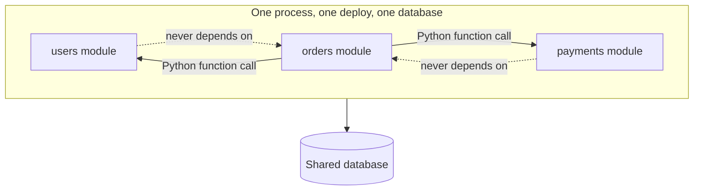

# Chapter 17 — Monolith Architecture

## Concept

A **modular monolith**: one deployable process, one database, but internally organized into
domain-scoped modules (Users, Orders, Payments) with clear boundaries between them — as opposed to
either a tangled "big ball of mud" monolith or a full microservices split.

## Why it exists

Microservices solve real problems (independent scaling, independent deployment, team autonomy) at a
real cost (network calls where function calls used to be, distributed transactions, operational
overhead). Most systems — especially early on — don't yet have the problems microservices solve, and pay
the cost anyway if they jump straight there. A modular monolith gets you clean domain boundaries *now*,
cheaply, while keeping the option to physically split a module into its own service *later*, once you
actually need to.

## Mental model

**Organize by domain, not by technical layer, at the top level.** Chapter 3 organized a single domain
by layer (`api/`, `services/`, `repositories/`). This chapter organizes a whole *application* by domain
first (`users/`, `orders/`, `payments/`), each of which could internally use chapter 3's layering.

## Diagram



## Realistic example

```
app/
├── users/router.py        # owns user data + endpoints
├── orders/router.py        # calls INTO payments as a plain function call
├── payments/service.py     # has ZERO knowledge of orders or users
└── main.py                 # wires all three routers together
```

`orders/router.py`'s `create_order` calls `payments.service.charge(...)` directly — a normal Python
function call, not an HTTP request to another service and not a message on a queue. This is the
**internal API** between modules: a clean function-level boundary, even though everything runs in the
same process. `payments/service.py` importing nothing from `orders` or `users` is deliberate — the
dependency graph is a DAG (Orders → Payments, Orders → Users), never circular.

```bash
cd chapter17
PYTHONPATH=. uvicorn app.main:app --reload --port 8000
curl -X POST "localhost:8000/orders?user_id=1&amount_cents=5000"   # 201, calls payments internally
curl -X POST "localhost:8000/orders?user_id=999&amount_cents=5000" # 404, never reaches payments at all
```

## Service boundaries, shared database, internal APIs, deployment

- **Service boundaries**: enforced by code organization and import discipline (no `payments` importing
  from `orders`), not by network calls — the boundary is social/architectural, not physical, yet.
- **Shared database**: all three modules can read/write the same Postgres instance. This is *the* thing
  that changes first and hardest if you later split into microservices (chapter 18) — a shared DB is
  the tightest possible coupling between modules.
- **Internal APIs**: the function signatures modules expose to each other (`charge(user_id,
  amount_cents) -> dict`) *are* the contract. Keep them as deliberate and stable as you would a real
  HTTP API — this is exactly what makes a later split to a real network call comparatively painless.
- **Deployment**: one artifact, one deploy pipeline, one set of runtime dependencies — genuinely simpler
  operationally than microservices, which is the main argument *for* staying a monolith as long as it
  fits.

## Why a monolith can be a deliberate choice

A small team, a product still finding its shape, and a system with no proven need for independently
scaling one module 100x more than another are all reasons a monolith is *correct*, not merely
"not yet advanced enough." Premature microservices split cost (network latency, partial-failure
handling, distributed debugging) without buying anything a monolith wasn't already providing.

## Common mistakes

- Letting module boundaries blur under deadline pressure — `payments` starts importing something from
  `orders` "just this once," and six months later the dependency graph is circular and nothing can be
  extracted cleanly.
- Sharing database tables across module boundaries directly (Orders code doing raw SQL against Payments'
  tables) instead of going through Payments' own function/API — this is the same IDOR-flavored problem
  as skipping a service layer, just at the module level.
- Never revisiting the boundaries — the DAG that made sense at 3 modules can degrade badly at 15 without
  active maintenance.

## Production considerations

- A well-bounded modular monolith is the ideal starting point for chapter 18's eventual extraction: if
  `payments/service.py`'s `charge()` function is truly the only entry point `orders` uses, replacing its
  body with an HTTP call to a new standalone Payments service is a comparatively small, contained change.
- Keep an explicit dependency direction diagram (like the one above) up to date as modules grow — it's
  cheap now and expensive to reconstruct later by reading imports across a large codebase.

## Exercise

Add a `notifications` module that sends an order-confirmation notification after a successful order.
Decide, and justify: should `orders` call `notifications` synchronously (function call, like `payments`),
or should it publish an event instead (chapter 13-14)? What makes this case different from the payment
charge, which you kept synchronous?

## Interview-style scenario

> "Six months from now, `payments` needs to scale to 50x the request volume of `users` and `orders`
> combined, due to a new high-volume partner integration. Given the module boundaries in this chapter,
> what would extracting `payments` into its own service actually require changing — and what would it
> NOT require changing, specifically because of how the boundary was drawn?"
