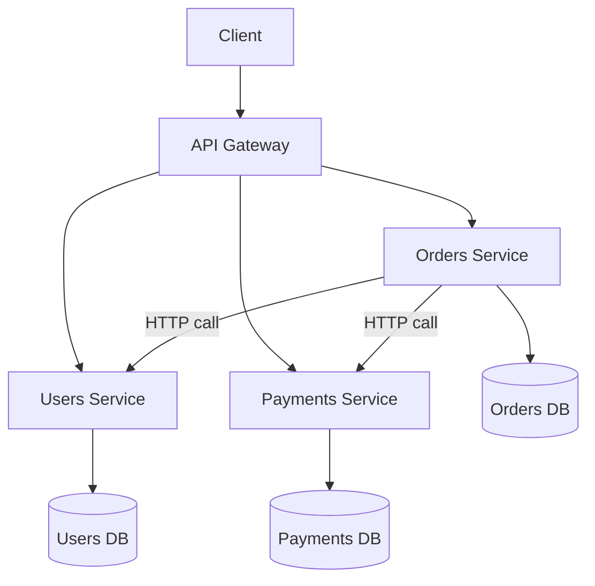

# Chapter 18 — Microservices

## Concept

Each service is its own deployable process, typically with its own database, communicating over the
network (HTTP, gRPC, or async messaging) rather than via in-process function calls.

## Why it exists

Once a module genuinely needs to scale independently, deploy independently, or be owned by a separate
team with its own release cadence, keeping it inside the monolith becomes the constraint. Microservices
let Payments scale to 50x traffic without scaling Users or Orders, let one team deploy Payments five
times a day without coordinating with the Orders team, and let a bug in Orders' dependencies not affect
Payments' runtime at all.

## Mental model

**The exact same function call from chapter 17 becomes a network call.** `orders.router.create_order`
calling `payments.service.charge()` in-process becomes Orders service calling `POST
/charges` on a separate Payments service over HTTP. Same logical dependency; fundamentally different
failure modes.

## Diagram



## Realistic example — actually two live services

This chapter runs **two real, separate FastAPI processes**:
- `app/users_service/main.py` — its own app, its own port (8001), its own in-memory "database."
- `app/orders_service/main.py` — its own app, its own port (8002), calls Users over real HTTP via
  `httpx.AsyncClient`.

```bash
cd chapter18
PYTHONPATH=app/users_service uvicorn main:app --port 8001 &
PYTHONPATH=app/orders_service USERS_SERVICE_URL=http://localhost:8001 uvicorn main:app --port 8002 &

curl -X POST "localhost:8002/orders?user_id=1&amount_cents=2500"
# {"id":1,"user_id":1,"user_email":"ada@example.com","amount_cents":2500}
# Orders service made a REAL network call to Users service to get that email.

curl -X POST "localhost:8002/orders?user_id=999&amount_cents=2500"
# {"detail":"User not found"} -- 404 propagated from Users service, through Orders, to the client

kill %1   # kill the Users service
curl -X POST "localhost:8002/orders?user_id=1&amount_cents=2500"
# {"detail":"Users service unavailable"} -- 503, a failure mode that literally
# could not exist in chapter 17's in-process function call
```

That last call is the whole point of this chapter: **a dependency going down is now a real,
first-class failure your code must handle explicitly** (`fetch_user`'s `try/except httpx.RequestError`
in `orders_service/main.py`) — chapter 17's `payments.service.charge()` could raise a Python exception,
but it could never time out or be "network unreachable."

## API Gateway

`app/gateway_concept.py` sketches the shape of an API gateway: a single entry point that routes
`/users/*` to the Users service and `/orders/*` to the Orders service, so external clients only need to
know one hostname. In production this is usually a dedicated product (Kong, AWS API Gateway, Envoy) —
this file is for understanding the concept, not a production gateway implementation.

## Service discovery, sync vs async communication, distributed transactions

- **Service discovery**: this chapter hardcodes `USERS_SERVICE_URL` as an env var — fine for two
  services on localhost. At real scale, services register themselves (or a service mesh/DNS-based
  discovery) so callers don't hardcode addresses that change as instances scale up/down.
- **Sync vs async communication**: Orders → Users here is synchronous HTTP (Orders needs the user's
  email *right now* to build the response). Contrast with chapter 13-14/15's event-driven pattern for
  things that don't need to block the caller.
- **Distributed transactions**: chapter 17's `charge()` + order creation happened atomically in one
  Python call stack. Across two services, there's no single database transaction spanning both — if the
  charge succeeds but writing the order fails, you have an inconsistent state. This is what patterns
  like the **Saga pattern** (a sequence of local transactions with compensating actions on failure)
  exist to address — genuinely harder than a monolith's transaction boundary.

## Common mistakes

- Splitting services along technical lines (a "database service," an "auth service" shared by
  everything) instead of domain lines — this tends to create a distributed monolith: all the network
  overhead of microservices, none of the independent-deployability benefit.
- No timeout on inter-service HTTP calls — a hung downstream service can hang your entire request chain
  indefinitely (`fetch_user` here sets `timeout=2.0` deliberately).
- Treating a network call exactly like a function call in your error handling — chapter 21 (Resilience)
  covers retries, circuit breakers, and timeouts properly; this chapter's bare try/except is the
  minimum, not the final answer.

## Production considerations

- Every inter-service call needs a timeout, and ideally a retry policy with backoff (chapter 21) — a
  service with no timeout on its outbound calls will eventually get stuck waiting on something.
- Observability (chapter 22) matters far more here than in a monolith — debugging "why did this order
  fail" now means correlating logs across two or more services, which is impossible without a shared
  request ID passed through every hop.

## Exercise

Add a Payments service (port 8003) and update the Orders service to call it, exactly as chapter 17's
`payments.service.charge()` did in-process. Then deliberately make Payments slow (`await
asyncio.sleep(5)`) and observe what happens to Orders' response time with no timeout, then fix it with
one.

## Interview-style scenario

> "In chapter 17's monolith, creating an order and charging a payment happened in one atomic operation.
> In this chapter's microservices version, what happens if the payment charge succeeds but the network
> call back to Orders times out before Orders can record the order as paid? What data inconsistency
> results, and what would you need to add to detect and correct it?"
