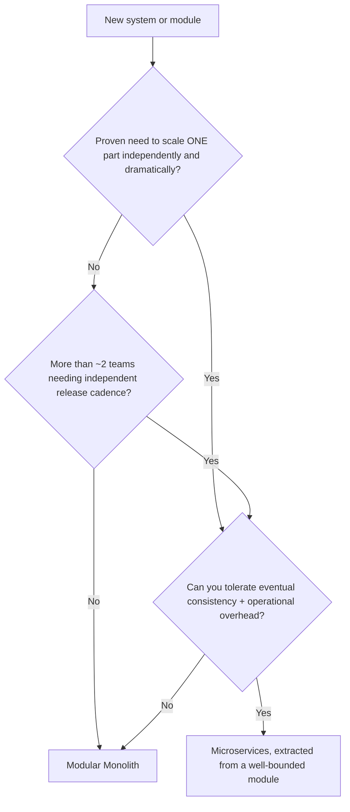

# Chapter 19 — Monolith vs Microservices

## Concept

Neither architecture is universally better. This chapter is a decision framework, not a verdict — you
felt both directly in chapters 17 and 18; now compare them explicitly, dimension by dimension.

## The comparison

| Dimension | Modular Monolith | Microservices |
|---|---|---|
| **Development** | One codebase, one set of dependencies, simpler local setup | Multiple repos/services, more setup per developer, but teams can work independently |
| **Deployment** | One deploy, all-or-nothing | Independent deploys per service, but more pipelines to maintain |
| **Scaling** | Scale the whole process, even if only one module is hot | Scale exactly the service under load, independently |
| **Data ownership** | Shared database, easy joins, easy consistency | Each service owns its data, no cross-service joins, eventual consistency |
| **Debugging** | One process, one log stream, a debugger attaches to everything | Distributed tracing required (chapter 22); "why did this fail" spans services |
| **Transactions** | Real ACID transactions across modules, trivially | Sagas/compensating actions; no free lunch (chapter 18) |
| **Team structure** | Works well for one team, or a few teams with strong coordination | Enables autonomous teams owning a service end-to-end |
| **Operational complexity** | Low — one thing to run, monitor, and understand | High — service discovery, inter-service auth, network policies, more moving parts |
| **Failure modes** | A bug can take down the whole app; but no network partial failures | Failure isolation between services; but partial failures (chapter 18's 503) are now routine |
| **Infrastructure** | One deployment target, one database | Multiple deployment targets, multiple databases, often a message broker too |

## Diagram — the decision

## Scenarios — work through these yourself

For each, decide: monolith or microservices, and why.

1. **A 3-person startup building an MVP**, unsure yet which features will matter, needs to ship fast and
   iterate based on user feedback.
2. **A 200-engineer company** with 15 teams, where Payments needs PCI compliance isolation and 24/7
   on-call ownership separate from the Catalog team.
3. **A single feature (image thumbnail generation)** that's CPU-intensive and needs to scale to 50
   instances during traffic spikes, while the rest of the app needs only 3 instances.
4. **A team of 6 engineers** currently running a monolith that's become slow to deploy (45-minute CI)
   because every change re-tests the entire codebase, even unrelated modules.

(Scenario 1: monolith — speed of iteration and low overhead matter far more than scaling concerns that
don't exist yet. Scenario 2: microservices — the compliance/on-call boundary is a real organizational
need, not just a technical preference. Scenario 3: this is the classic case for extracting *one* service
while keeping the rest monolithic — you don't need a full microservices rewrite to solve one scaling hot
spot. Scenario 4: worth investigating whether the *real* problem is test suite architecture/CI
parallelization before concluding a rewrite into microservices is the fix — a slow monolith's CI is often
a build-tooling problem, not an architecture problem.)

## Common mistakes

- Choosing microservices because they're perceived as "the modern/correct way to build things," not
  because a proven organizational or scaling need exists.
- Choosing to stay a monolith purely out of inertia, past the point where team coordination overhead or
  a genuine scaling bottleneck is costing more than a targeted extraction would.
- All-or-nothing thinking — the realistic middle path is usually "monolith, with one or two modules
  extracted where there's a proven, specific reason," not a binary choice for the whole system.

## Production considerations

- The cheapest time to design clean module boundaries is *before* you need to decide whether to extract
  them — chapter 17's discipline (a DAG of dependencies, no module reaching into another's data) is what
  makes chapter 19's decision a business/organizational one instead of a months-long untangling project.
- Revisit this decision periodically, not once. A monolith that was correct at 5 engineers may not be
  correct at 50; a microservices split done early for 3 services may prove to be premature overhead if
  the org never grew the teams to independently own them.

## Exercise

Take chapter 17's modular monolith and write a one-page migration plan for extracting *just* the
Payments module into its own service (chapter 18's version already shows the destination) — list the
specific steps, in order, and specifically what could go wrong at each step.

## Interview-style scenario

> "Your CTO wants to move to microservices because 'that's how [well-known company] does it.' How do you
> respond, and what questions would you ask to figure out whether that's actually the right call for
> your specific team and system?"
