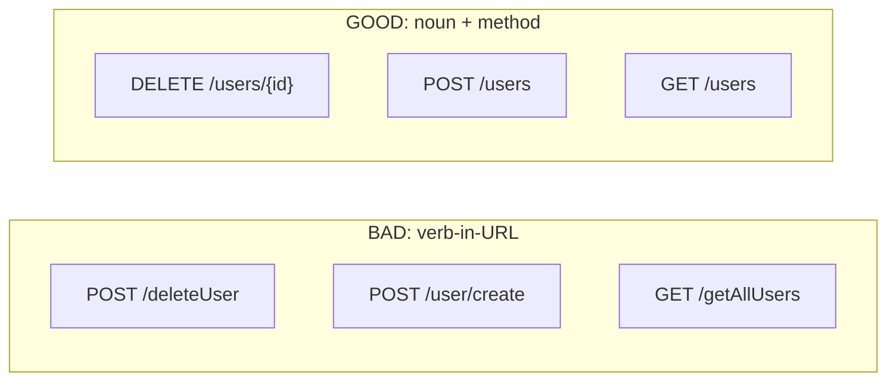

# Chapter 2 — REST API Design

## Concept

REST (Representational State Transfer) is a set of constraints for designing networked APIs around
**resources** (nouns) manipulated via a small, fixed set of **HTTP methods** (verbs), using status
codes to convey outcome. It is a design discipline, not a library — FastAPI doesn't enforce any of this
for you.

## Why it exists

Without a shared convention, every API invents its own verbs (`/getAllUsers`, `/user/create`,
`/deleteUser`) and every client has to learn each one from scratch. REST's constraint — "the method
carries the verb, the URL names the resource" — makes APIs predictable: if you know `/users` exists,
you can guess `GET /users`, `POST /users`, `GET /users/{id}`, `DELETE /users/{id}` all work, roughly the
way you expect, before reading a single line of docs.

## Mental model

**URLs are nouns. Methods are verbs. Status codes are the sentence's tone.**

| Method | Meaning | Safe? | Idempotent? |
|--------|---------|-------|-------------|
| GET | Read | Yes | Yes |
| POST | Create (or trigger an action) | No | No |
| PUT | Replace entirely | No | Yes |
| PATCH | Partial update | No | No* |
| DELETE | Remove | No | Yes |

*PATCH is not idempotent in general (e.g. `{"increment": 1}`), though many PATCH endpoints that just
set absolute field values happen to be idempotent in practice.

**Safe** = doesn't change server state. **Idempotent** = calling it N times has the same effect as
calling it once. These two properties are what let browsers, proxies, and retry logic behave correctly
without knowing anything about your specific API.

## Diagram — good vs bad



## Minimal example

```
GET    /users          list
GET    /users/{id}     read one
POST   /users          create
PATCH  /users/{id}     partial update
PUT    /users/{id}     full replace
DELETE /users/{id}     remove
```

## Realistic example

See `app/bad_example.py` and `app/good_example.py` in this folder — the same "users" API, once done
wrong (action verbs in URLs, wrong status codes, no pagination) and once done right.

## PUT vs PATCH, and POST vs PUT

- **PUT vs PATCH**: PUT sends the *whole* resource and replaces it — if you omit a field, it's often
  treated as cleared. PATCH sends only the fields that changed. Prefer PATCH for anything with more
  than 3-4 fields; PUT becomes a footgun (client forgets a field, silently nukes it).
- **POST vs PUT for "create"**: use PUT to create when the *client* decides the resource's ID (e.g.
  `PUT /users/alice`, idempotent — calling it twice with the same body is a no-op the second time). Use
  POST when the *server* assigns the ID (`POST /users` → server returns `201` with the new `id`) —
  calling it twice creates two resources, which is why POST is never idempotent.

## Idempotency with real examples

`DELETE /orders/42` twice: first call removes it and returns 204 (or 404 if you're strict), second call
returns 404 either way — **the end state is identical**, so DELETE is idempotent even though the second
response differs from the first. Idempotency is about *server state*, not *response body*.

Contrast: `POST /orders` twice with the same payload creates two orders. If a client's retry logic
resends a POST after a timeout (not knowing if the first request succeeded), you get duplicate orders
unless you add an **idempotency key** (a client-generated UUID stored server-side to dedupe retries) —
this is exactly how Stripe's API avoids double-charging on network retries.

## Pagination, filtering, sorting, searching

```
GET /orders?limit=20&offset=40                  # offset pagination — simple, breaks under high writes
GET /orders?cursor=eyJpZCI6MTIzfQ&limit=20      # cursor pagination — stable under concurrent writes
GET /orders?status=shipped&customer_id=88       # filtering
GET /orders?sort=-created_at,total_cents        # sorting, "-" prefix for descending
GET /orders?search=blue+widget                  # simple search
```

Cursor pagination is worth the extra complexity once a table is written to concurrently with being
paginated — offset pagination can skip or repeat rows as new rows are inserted ahead of the cursor.

## Versioning

```
/v1/users        # URL versioning -- simplest, most visible, what most public APIs use
Accept: application/vnd.myapi.v1+json   # header/content-negotiation versioning -- cleaner URLs, harder to explore in a browser
```

Version when you make a **breaking** change (removing/renaming a field, changing a type, changing
required-ness). Adding a new optional field is *not* a breaking change — don't version for that.

## Error responses — a consistent contract

```json
{
  "error": {
    "code": "PRODUCT_OUT_OF_STOCK",
    "message": "Product 42 is out of stock",
    "request_id": "8f14e45f-ceea-467e-9d5a"
  }
}
```

Every error, regardless of which endpoint threw it, should have the same envelope shape. This is what
lets a frontend write one generic error handler instead of one per endpoint. Chapter 9 builds this
properly as a global exception handler.

## HATEOAS (basics)

The idea: responses include links to related actions/resources, so a client can navigate the API
without hardcoding URL structure.

```json
{
  "id": 42, "status": "pending",
  "_links": {
    "self": "/orders/42",
    "cancel": "/orders/42/cancel",
    "customer": "/customers/88"
  }
}
```

In practice, few teams go full HATEOAS — it adds real payload/complexity cost. Know it exists and why
(discoverability, reduced client-server coupling on URL structure); don't feel obligated to implement it.

## Common mistakes

- Verbs baked into URLs (`/getAllUsers`) instead of relying on the HTTP method.
- Returning `200 OK` with an `{"error": ...}` body instead of an actual 4xx/5xx status — this breaks
  every HTTP-aware tool (caches, monitoring, retries) that inspects the status code, not the body.
- Unbounded collection endpoints with no pagination — fine at 50 rows, an outage at 5 million.
- Inconsistent pluralization/casing across endpoints (`/user/{id}` next to `/orders`).

## Production considerations

- Decide your versioning strategy **before** your first external consumer — retrofitting is painful.
- Document idempotency guarantees explicitly for POST endpoints that clients might retry (payments,
  order creation) and consider supporting an `Idempotency-Key` header.
- Pagination defaults matter: an unbounded default `limit` is a denial-of-service vector waiting to
  happen the day your table stops being small.

## Exercise

Take `app/bad_example.py` and rewrite every endpoint to be REST-compliant, including status codes,
pagination on the collection endpoint, and a consistent error envelope for the 404/400 cases. Compare
your version against `app/good_example.py`.

## Interview-style scenario

> "Design the URL structure and methods for a 'like' feature on a post — a user can like a post once,
> unlike it, and see whether they've liked it. Is 'like' a resource? What HTTP method creates a like?
> What happens if the same user calls 'like' twice — should it error, or be idempotent?"

(A common answer: model the like as a sub-resource, `PUT /posts/{id}/like` — idempotent by construction,
since PUT-ing the same "I like this" state twice leaves it liked either way. `DELETE
/posts/{id}/like` to unlike.)
