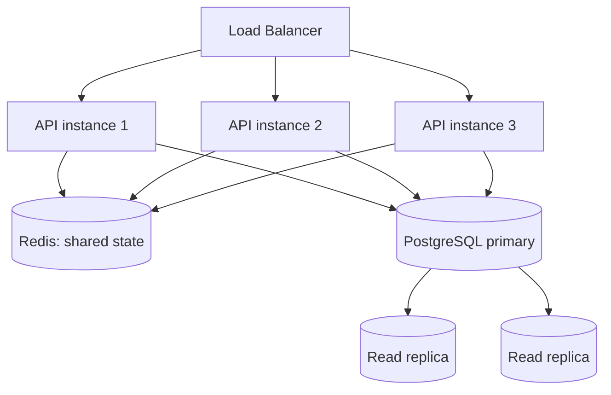

# Chapter 20 — Scalability

## Concept

Scalability is a system's ability to handle increased load by adding resources. **Vertical scaling**
gives one machine more CPU/RAM. **Horizontal scaling** adds more machines running the same service
behind a load balancer.

## Why it exists

Vertical scaling has a hard ceiling (the biggest machine money can buy) and a single point of failure
(one machine, one outage). Horizontal scaling has no hard ceiling and survives individual machine
failure — but it only works cleanly if your service can run as many identical, interchangeable copies,
which requires statelessness.

## Mental model — the one idea this chapter is built around

**A horizontally-scaled service must not depend on any single instance's memory to be correct.** If
request 1 hits instance A and request 2 (same client, next second) hits instance B, both requests must
see the same world — meaning shared state has to live somewhere both instances can reach: a database, a
cache, or a message queue, never a Python variable inside one process.

## Demonstrated, not just described

`app/stateless_demo.py` has two versions of a counter: `StatefulInstance` (in-process) and
`StatelessInstance` (Redis-backed). `app/tests/test_statelessness.py` simulates a load balancer
alternating between two instances of each, and asserts the actual, different, measured results:

```
stateful (alternating instances):  [1, 1, 2, 2]   <- WRONG: each instance only saw half the traffic
stateless (alternating instances): [1, 2, 3, 4]   <- CORRECT: shared state, consistent regardless of instance
```

This is not a hypothetical — this exact bug class (in-memory session state, in-memory rate limiter,
in-memory cache) is one of the most common production incidents caused by scaling a monolith
horizontally without first removing per-process state. It's also why chapter 10's rate limiter uses
Redis, not a Python dict.

## Diagram — a horizontally scaled architecture



## Scaling each layer

- **Load balancing**: distributes requests across instances (round-robin, least-connections, etc.) —
  requires statelessness to work correctly, as demonstrated above.
- **Connection pooling** (chapter 4): each of your N instances needs its own pool; total connections to
  Postgres = N × pool_size, which must stay under Postgres's `max_connections`.
- **Caching** (chapter 12): moves read load off the database entirely for hot keys.
- **Database read replicas**: route read-heavy queries to replicas, writes to the primary — works well
  when your workload is read-heavy and can tolerate slight replication lag for reads.
- **Queue-based architecture** (chapters 13-15): absorbs traffic spikes by buffering work instead of
  forcing every request to be processed synchronously at peak rate.
- **CDN**: serves static assets (and sometimes cacheable API responses) from edge locations, never
  touching your origin servers at all for those requests.
- **Rate limiting** (chapter 10) and **backpressure**: protect the system from being overwhelmed rather
  than trying to scale infinitely to absorb any load thrown at it.

## Common mistakes

- In-memory rate limiters, session stores, or caches that silently stop working correctly (not
  crashing — just becoming *wrong*, per the demo above) the moment you scale past one instance.
- Scaling the API layer without checking whether the database is actually the bottleneck — 10 API
  instances hammering one undersized Postgres instance just moves the queue from your load balancer to
  your database's connection pool.
- No connection pool math (chapter 4) — scaling instance count without checking `N × pool_size <
  Postgres max_connections` is a self-inflicted outage waiting for a traffic spike.

## Common bottlenecks, in likely order for a typical CRUD API

1. Database (connections, slow queries, missing indexes, N+1s — chapter 4)
2. Any in-memory state that silently breaks under horizontal scaling (this chapter)
3. Synchronous calls to slow external dependencies with no timeout (chapters 18, 21)
4. CPU-bound work blocking the event loop (chapter 11)

## Production considerations

- Auto-scaling only works safely for genuinely stateless instances — verify this explicitly before
  turning it on, not after an incident reveals a hidden per-instance state bug.
- Load test with realistic concurrent traffic, not sequential requests — many scaling bugs (this
  chapter's, chapter 11's) are invisible under low concurrency and only appear under real load.

## Exercise

Take chapter 10's rate limiter test suite and rerun it, but first swap `TokenBucketRateLimiter`'s Redis
client for two separate `StatefulInstance`-style in-memory dicts, one per "instance" — show precisely
how the rate limit becomes 2x looser than configured the moment you have 2 instances instead of 1.

## Interview-style scenario

> "Your API currently runs as a single instance and works fine. Ops wants to scale it to 4 instances
> ahead of a traffic spike. What's your checklist of things to verify BEFORE that scale-up, based on
> everything in this chapter?"
