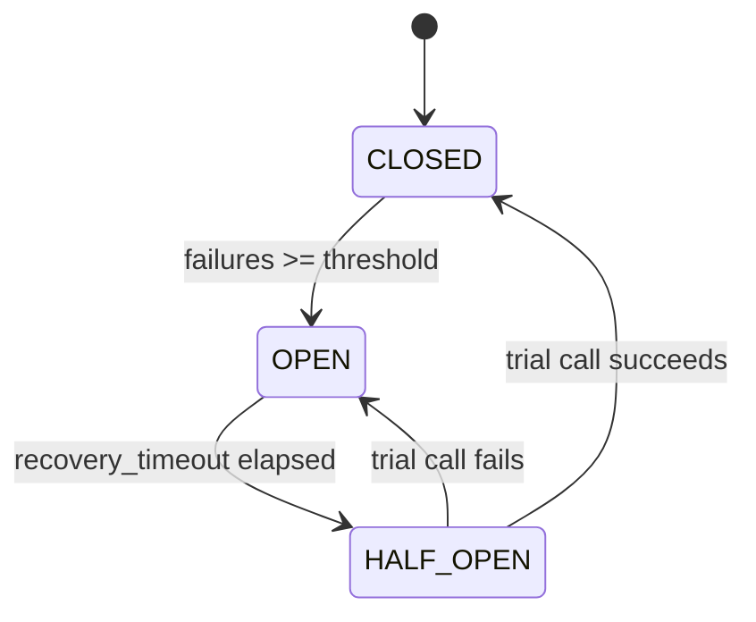

# Chapter 21 — Resilience

## Concept

Resilience patterns handle the reality chapter 18 introduced: dependencies fail, time out, and become
slow. Timeouts, retries, circuit breakers, bulkheads, idempotency, and graceful degradation are the
toolkit for surviving that reality instead of cascading it.

## Why it exists

Without these patterns, one slow or failing dependency can take down every service that calls it —
threads/connections pile up waiting on a hung dependency, retries without limits hammer an already
struggling service harder, and a single point of failure becomes a system-wide outage.

## The toolkit

| Pattern | What it does | Chapter's implementation |
|---|---|---|
| **Timeout** | Bound how long you'll wait for a response | `httpx` client `timeout=` param (chapter 18) |
| **Retry + exponential backoff** | Re-attempt transient failures, waiting longer each time | `app/retry_demo.py`, via `tenacity` |
| **Circuit breaker** | Stop calling a consistently-failing dependency for a while | `app/circuit_breaker.py` |
| **Bulkhead** | Isolate resources per dependency so one slow one can't exhaust a shared pool | Separate connection pools/thread pools per downstream call |
| **Idempotency** | Make retried operations safe to repeat | Chapter 2's idempotency-key discussion |
| **Backpressure** | Push back on load instead of accepting unlimited queued work | Chapter 10's rate limiting |
| **Graceful degradation** | Return a reduced-but-useful response instead of a hard failure | E.g. serve stale cached data if the DB is unreachable |

## Diagram — circuit breaker states



**CLOSED**: normal operation, calls go through, failures are counted. **OPEN**: failing fast — calls are
rejected immediately without even attempting the real dependency, protecting both the struggling
dependency (no more load) and your own latency (no more waiting on doomed calls). **HALF_OPEN**: after a
cooldown, exactly one trial call is allowed through to test recovery.

## Demonstrated, not just described

`app/tests/test_resilience.py` exercises the full lifecycle:
- 3 consecutive failures trip the breaker to OPEN; a 4th call fails **immediately** with
  `CircuitOpenError`, never even calling the (still-broken) dependency function.
- After `recovery_timeout` elapses, one call is allowed through (HALF_OPEN); if it succeeds, the breaker
  fully resets to CLOSED.
- The retry decorator (`app/retry_demo.py`, backed by `tenacity`) retries a function that fails twice
  then succeeds, confirming success on the 3rd attempt — and separately confirms a `PermanentError` is
  **not** retried at all (`retry_if_exception_type` filters by exception type).

```bash
cd chapter21
PYTHONPATH=. pytest app/tests -v
```

## Service A → B → C, and what happens when C goes down


Without resilience patterns: C goes down → B's calls to C start timing out slowly (or hang forever with
no timeout) → B's own resources (threads, connections) get tied up waiting → A's calls to B start
timing out too, for the same reason → the failure has now propagated backward through the whole chain,
turning one dependency's outage into three services' outages.

With patterns applied at each hop: B has a timeout and a circuit breaker on its calls to C. Once C's
failure rate crosses the threshold, B's breaker opens — B starts failing fast (or serving a degraded
response) instead of hanging, which keeps B's own resources free and A's calls to B fast, even though C
is still down.

## Common mistakes

- Retrying without a cap or without backoff — a naive infinite retry loop against a struggling
  dependency actively makes the outage worse (this is sometimes called a "retry storm").
- Retrying non-idempotent operations blindly — retrying a payment charge that actually succeeded but
  whose response was lost to a network blip can double-charge a customer without an idempotency key.
- No circuit breaker at all — every single request pays the full timeout cost while a dependency is
  down, instead of failing fast after the first few failures establish a pattern.
- Setting timeouts so generous they're effectively no timeout (30+ seconds) — by the time it fires,
  plenty of damage (resource exhaustion, user-facing latency) has already happened.

## Production considerations

- Tune circuit breaker thresholds per dependency based on its actual failure characteristics, not one
  global default — a flaky-but-recoverable dependency needs different tuning than a rarely-failing,
  slow-to-recover one.
- Combine patterns: retry with backoff *inside* a circuit breaker (stop retrying once the breaker is
  open — retrying against an open circuit defeats its purpose).
- Alert on circuit breakers opening — an open breaker means a real, currently-happening dependency
  failure, exactly the kind of signal that should page someone, not go unnoticed.

## Exercise

Combine `CircuitBreaker` and the `tenacity` retry decorator: wrap calls in a retry that gives up early
(without exhausting all attempts) if the circuit is already open, instead of retrying into a wall.

## Interview-style scenario

> "Your circuit breaker's `failure_threshold` is 5 and `recovery_timeout` is 30 seconds. During a
> partial outage, the dependency fails 4 times, recovers for a moment, then fails again. Walk through
> exactly what the breaker's state does across this sequence, and explain why counting *consecutive*
> failures (versus failures in a sliding time window) matters here."
