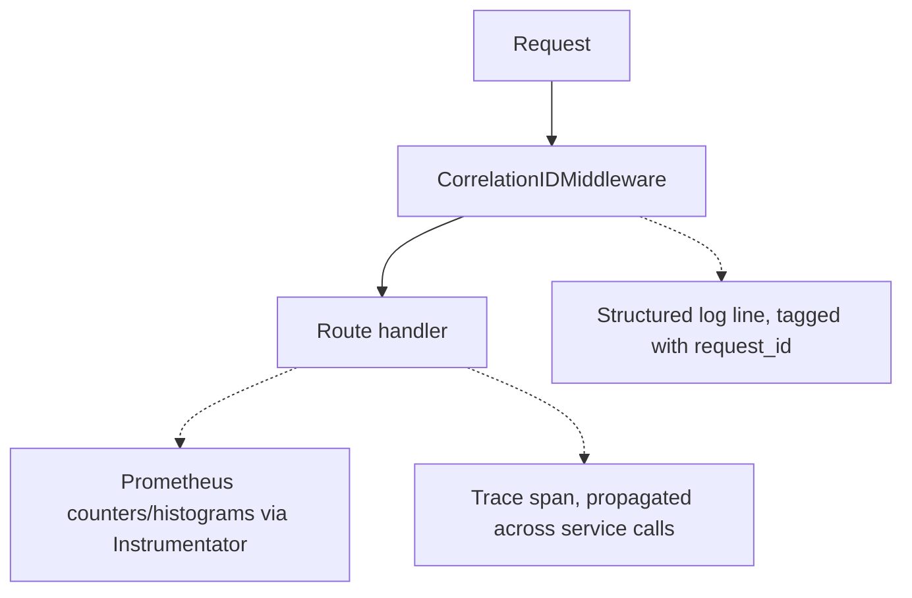

# Chapter 22 — Observability

## Concept

Observability is the ability to understand what's happening inside a running system from its outputs:
**logs** (discrete events), **metrics** (aggregated numbers over time), and **traces** (a request's
path across services). Health/readiness checks are a special, operationally critical case built on top
of these.

## Why it exists

You cannot fix — or even notice — what you cannot see. In a monolith, a debugger and a single log file
get you far. Once you have multiple instances (chapter 20), multiple services (chapter 18), and
asynchronous processing (chapters 13-16), understanding "why did this one request fail" requires
deliberately engineered observability — it doesn't happen for free.

## Mental model

```
Request arrives → FastAPI
   ├── Logs:   discrete events, tagged with a correlation ID, greppable after the fact
   ├── Metrics: aggregated counters/histograms (request count, latency), queried for trends and alerts
   └── Trace:  the request's path across every service/hop it touched, for one specific request
```

## Diagram



## Liveness vs readiness — a distinction that matters operationally

`app/main.py` implements both, deliberately different:

- **`/health` (liveness)**: "is this process alive at all?" Cheap, no dependency checks. If this fails,
  an orchestrator (Kubernetes, etc.) **restarts the process** — appropriate only when the process itself
  is broken (deadlocked, out of memory), never appropriate as a response to "the database is down,"
  since restarting the process does nothing to fix that and just adds churn on top of an existing outage.
- **`/ready` (readiness)**: "can this instance actually serve traffic right now?" Checks real
  dependencies. If this fails, a load balancer **stops routing traffic to this instance** (without
  killing it) — exactly the right response to "the database is temporarily unreachable": stop sending
  this instance work it can't do, without restarting a perfectly healthy process.

`app/tests/test_observability.py` proves this distinction concretely: simulating a database outage
(`DependencyStatus.database_up = False`) leaves `/health` returning 200 (the process is still alive) but
`/ready` returning 503 (it genuinely can't serve most requests) — mixing these two up is a common,
costly production mistake.

## Metrics

`Instrumentator().instrument(app).expose(app, endpoint="/metrics")` auto-instruments every route with
Prometheus-format counters and latency histograms, with zero per-route code. Run the app and hit
`/metrics` to see request counts and latency buckets accumulate as you make requests.

## Correlation IDs, tying logs together

`CorrelationIDMiddleware` (building directly on chapter 8) assigns/propagates an `X-Request-ID` and
includes it in every log line for that request. In a single-service demo this is convenient; in a
multi-service system (chapter 18) it's the *only* practical way to reconstruct "everything that happened
for this one request" across service boundaries — every service in the chain must extract and forward
the same ID.

```bash
cd chapter22
PYTHONPATH=. pytest app/tests -v
PYTHONPATH=. uvicorn app.main:app --reload --port 8000
curl -i localhost:8000/health     # 200 always
curl -i localhost:8000/ready      # 200 while dependencies are up
curl localhost:8000/metrics       # Prometheus text format
```

## Common mistakes

- Making liveness checks call the database — the exact anti-pattern this chapter warns against: a DB
  blip now causes cascading process restarts across your whole fleet instead of a clean "stop routing
  here" signal.
- Logging without a correlation ID — in production, "grep the logs for this user's failed request"
  becomes "grep the logs for roughly the right few seconds and guess," across potentially several
  services' worth of log volume.
- Metrics with unbounded label cardinality (e.g. a Prometheus label containing a raw user ID or request
  path with IDs in it) — this can blow up your metrics storage; use route templates (`/orders/{id}`), not
  raw paths, as the instrumentator here already does by default.

## Production considerations

- Set Kubernetes (or your orchestrator's) liveness probe to `/health` and readiness probe to `/ready`
  explicitly — many teams accidentally point both at the same endpoint, silently reintroducing the
  liveness/readiness conflation this chapter exists to prevent.
- Alert on metrics (error rate, P99 latency, readiness failures), not on log content — logs are for
  investigation *after* an alert fires, not usually the trigger mechanism itself at scale.

## Exercise

Add a `/ready` dependency check for a message queue connection (simulate with a third `DependencyStatus`
flag). Then write a test proving that a queue outage alone (database and cache still healthy) correctly
flips readiness to `False`, and that liveness remains unaffected.

## Interview-style scenario

> "A service's liveness AND readiness probes are both pointed at the same endpoint, which checks the
> database. During a 10-minute database blip, what happens to the service's running instances in
> Kubernetes, and how is that different — worse, in this case — from having them point at correctly
> separated endpoints?"
