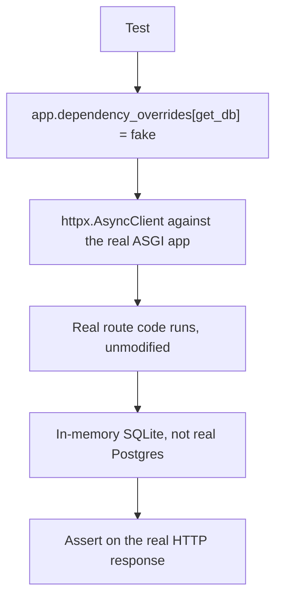

# Chapter 23 — Testing

## Concept

Testing a FastAPI app at multiple levels: unit tests (pure functions/business logic, chapter 3's
pattern), API tests (full request/response cycle via `TestClient`/`httpx.AsyncClient`), and integration
tests against a real (but isolated) database — using dependency overrides as the seam that makes all of
this fast and hermetic.

## Why it exists

Untested auth and authorization logic is the most expensive kind of bug to discover in production —
usually via a security incident, not a stack trace. FastAPI's dependency injection (chapter 5) exists
specifically to make this testable without spinning up real infrastructure for every test run.

## Mental model

**Override dependencies, don't mock imports.** `app.dependency_overrides[get_db] = override_get_db`
replaces exactly the dependency FastAPI resolves for `Depends(get_db)`, app-wide, for the duration of the
test — no monkeypatching internals, no fragile `unittest.mock.patch("app.main.SomeClass")` paths that
break the moment you refactor an import.

## Diagram



## Realistic example

`app/main.py` is a small Notes API: create/list/delete, with ownership-based authorization (chapter 7's
pattern) layered on top of a real async SQLAlchemy database (chapter 4's pattern).

`app/tests/conftest.py`'s `db_session` fixture is the core pattern:
```python
app.dependency_overrides[get_db] = override_get_db  # points at in-memory SQLite instead of Postgres
```

`app/tests/test_notes_api.py` then tests through **real HTTP requests** against the real app (via
`httpx.AsyncClient` + `ASGITransport`), proving genuinely important behaviors:
- `test_notes_are_isolated_per_user` — Bob's note never appears in Ada's list (chapter 7's IDOR concern,
  actually tested, not just asserted in a docstring).
- `test_cannot_delete_someone_elses_note` — Bob gets 403 trying to delete Ada's note; Ada gets 204
  deleting her own.
- `test_missing_auth_header_rejected` — proves FastAPI's own validation kicks in before your code even
  runs, for a required header.

```bash
cd chapter23
PYTHONPATH=. pytest app/tests -v
```

Every test gets a **fresh** in-memory SQLite database (`db_session` fixture creates and disposes the
engine per test) — no test pollution, no ordering dependencies between tests, no need for a running
Postgres at all.

## Overriding dependencies during testing

The general pattern, usable for anything behind `Depends()`:
```python
app.dependency_overrides[get_current_user] = lambda: {"email": "test@example.com"}
```
This is exactly chapter 5's payoff, applied at scale: auth, database, external API clients, feature
flags — anything injected via `Depends()` can be swapped for a test double with one line, without
touching route code at all.

## Unit vs API vs integration tests — what each buys you

- **Unit tests** (chapter 3's `test_users.py` style): test a service class directly, zero HTTP, zero DB.
  Fastest, most precise about *which* piece of logic broke.
- **API tests** (this chapter): test through the real HTTP interface, catching issues unit tests can't —
  wrong status codes, missing headers, serialization bugs, dependency wiring mistakes.
- **True integration tests** (against real Postgres/Redis, usually run less frequently, e.g. in CI only):
  catch things SQLite can't — Postgres-specific SQL behavior, actual connection pool exhaustion, real
  network latency to Redis.

A healthy test suite has far more of the first two than the third — reserve real-infrastructure
integration tests for what genuinely can't be verified any other way.

## Common mistakes

- Testing against a shared, persistent test database — tests then depend on execution order and leak
  state between runs, producing intermittent, hard-to-reproduce failures.
- Only testing the happy path — this chapter's app has 3 negative-case tests (missing auth, wrong owner,
  not found) alongside 1 happy-path test; a 1:1 or worse ratio is a red flag in most real codebases.
- Forgetting to clear `dependency_overrides` after a test (or between tests) — leaks into subsequent
  tests exactly like chapter 5 warned, causing confusing cross-test failures.

## Production considerations

- Run the full suite (SQLite-backed) on every commit; reserve a smaller, slower suite against real
  Postgres/Redis for CI on merge to main or nightly, catching the class of bug SQLite compatibility
  can't.
- Test authorization exhaustively — for every resource, explicitly test "owner can," "non-owner cannot,"
  and "unauthenticated cannot," as this chapter's `test_cannot_delete_someone_elses_note` does. This is
  the highest-value test category per line of test code in most APIs.

## Exercise

Add a test proving that creating a note with an empty `text` string is rejected (add a Pydantic
constraint, `min_length=1`, to enforce it if the current code doesn't already), and confirm the
FastAPI-level validation error test doesn't need any database or auth override to exercise.

## Interview-style scenario

> "A teammate says: 'why bother testing against a fake SQLite database when we run real Postgres in
> production — doesn't that mean the tests could pass while the real thing is broken?' How do you
> respond, and where would you draw the line on what SQLite-backed tests should and shouldn't be trusted
> to catch?"
