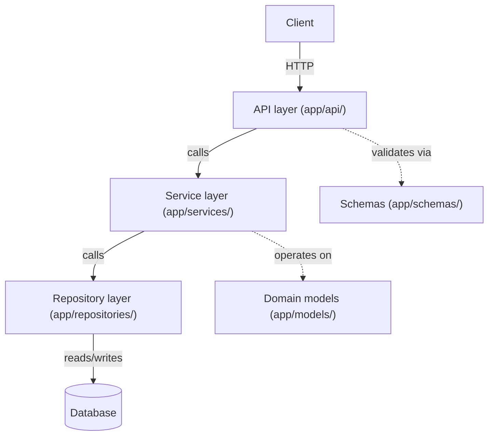

# Chapter 3 — FastAPI Project Architecture

## Concept

A layered architecture separates a request's handling into distinct responsibilities: **API** (HTTP
in/out), **Service** (business rules), **Repository** (persistence), **Schema** (validation/shape),
**Model** (domain/storage representation).

## Why it exists

Everything works fine when `@app.post("/users")` contains 5 lines. It stops working once that function
contains DB queries, business rules, external API calls, and error handling all tangled together —
at that point you can't unit test the business rule without a database, can't swap Postgres for
DynamoDB without touching HTTP code, and every new teammate has to read the whole function to find the
one `if` they need to change.

## Mental model

**Each layer should only need to change for one reason.**
- API layer changes when your HTTP contract changes.
- Service layer changes when a business rule changes.
- Repository layer changes when your storage technology changes.
If a single change (e.g. "emails must be unique") forces edits in three layers, something is misplaced.

## Diagram



## Why we don't put everything inside `@app.get(...)`

The route function should be a thin translator: HTTP request → typed call into the service → HTTP
response. Business logic inside the route function means:
- You can't call that logic from a CLI script, a background worker, or a test without going through HTTP.
- You can't unit test it without mocking `Request`/`Response` objects.
- Two endpoints that should share a rule (e.g. "check stock before allowing an order") end up
  duplicating it instead of both calling one service method.

## Realistic example

This chapter's `app/` is a full working slice:
```
app/
├── main.py                        # wires everything together
├── api/users.py                   # HTTP layer: parse, call service, map errors -> status codes
├── schemas/user.py                # Pydantic: what the wire format looks like
├── models/user.py                 # domain representation (a dataclass here; SQLAlchemy in ch4)
├── services/user_service.py       # business rule: emails must be unique
├── repositories/user_repository.py # storage, swappable independent of the service
├── dependencies/services.py       # wiring (Depends() targets) -- goes deep in chapter 5
└── tests/test_users.py            # unit tests the SERVICE directly, no HTTP, no DB
```

Run it:
```bash
cd chapter3
PYTHONPATH=. uvicorn app.main:app --reload --port 8000
PYTHONPATH=. pytest app/tests -v
```

Notice `test_users.py` never imports FastAPI. That's the payoff: the business rule ("duplicate email
raises") is tested in milliseconds, no HTTP server, no DB required.

## Common mistakes

- Importing the repository directly into the API layer, skipping the service — you'll eventually need
  a business rule between them and will have to retrofit it everywhere.
- Making the service layer depend on FastAPI types (`Request`, `HTTPException`) — this couples business
  logic to a specific web framework for no reason. Raise domain exceptions from the service
  (`DuplicateEmailError`) and translate them to HTTP status codes in the API layer, as this chapter does.
- One giant `models.py`/`schemas.py` file for the whole app. Fine at 3 resources, unreadable at 30.

## Production considerations

- This structure scales down fine for a single small service; for a monolith with many domains
  (Users, Orders, Payments), consider grouping by **domain module** instead of by **layer** at the top
  level (`app/users/{api,service,repository}.py`, `app/orders/{...}`) — see chapter 17.
- Dependency injection (chapter 5) is what makes `UserRepository` swappable for tests without editing
  `UserService`'s code — `app/dependencies/services.py` is the seam.

## Exercise

Add a `Product` domain following the exact same layering (schema, model, repository, service, api
router), then add a rule to `UserService`: a user cannot be deleted if they have any orders (you can
stub `OrderRepository.has_orders_for_user` returning `False` for now). Verify you only touched the
service layer to add that rule, not the API layer.

## Interview-style scenario

> "Your team wants to swap Postgres for MongoDB in six months, without downtime, one domain at a time.
> Which of your layers change, and which stay untouched? What would make that migration harder than it
> should be?"
