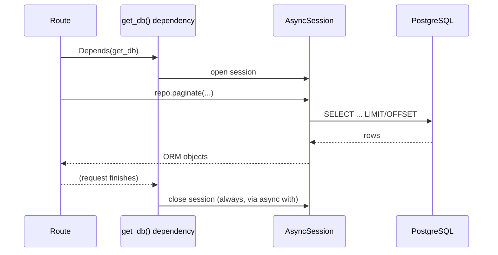

# Chapter 4 — Database Integration

## Concept

Connecting FastAPI to PostgreSQL via SQLAlchemy 2.0 (async) and managing schema changes with Alembic.

## Why it exists

An API without persistence is a demo. Real systems need durable storage, and SQLAlchemy is the de facto
standard ORM/query-builder for Python — it gives you a Pythonic query API while still letting you drop
to raw SQL when the ORM gets in the way (which, at scale, it eventually will for a handful of queries).

## Mental model

```
Request → FastAPI → Service → SQLAlchemy Session → asyncpg driver → PostgreSQL
```

A **Session** is a unit-of-work: a scope in which objects are tracked, changes are batched, and a
single `commit()` writes everything atomically. One session per request is the standard pattern (see
`get_db()` in `app/database.py`) — it's cheap to create and guarantees isolation between requests.

## Diagram



## Sessions, transactions, connection pooling

- **Session**: an in-Python object tracking loaded/changed entities; not the same as a raw DB
  connection.
- **Transaction**: implicit per session — SQLAlchemy opens one on first use and you `commit()` or
  `rollback()` explicitly (or the `async with` context manager rolls back on unhandled exceptions).
- **Connection pooling**: the engine (`app/database.py`) maintains a pool of live TCP connections to
  Postgres so you're not paying connection-setup cost on every request. `pool_size` is the steady-state
  pool; `max_overflow` is how far it can burst under load before requests start queueing.

## Async SQLAlchemy

Every DB call is `await`ed (`await session.execute(...)`) so the event loop can serve other requests
while waiting on network I/O to Postgres — this is the entire point of pairing FastAPI with an async
driver (`asyncpg`) instead of the classic sync `psycopg2`.

## Repository pattern

See `app/repository.py`: `BookRepository` is the only place that writes SQLAlchemy queries. Services
and routes call methods like `paginate()` and never see a `select()` statement. This is what makes it
possible to later swap the storage layer, or write test doubles, without touching business logic.

## The N+1 problem — shown, not just described

`app/repository.py` has **both** `list_naive()` and `list_with_authors()` on purpose:

```python
# list_naive(): 1 query for books, then N more queries -- one per book -- the
# moment something accesses book.author.name, because SQLAlchemy lazy-loads
# relationships by default.

# list_with_authors(): exactly 2 queries total, via selectinload(), regardless
# of whether there are 3 books or 3 million.
```

Run both endpoints with SQL echo on (`create_async_engine(..., echo=True)`) and count the queries in
your terminal — this is the single most common performance bug in ORM-backed APIs, and it's invisible
until you look at query counts, not query latency.

## Pagination + query optimization

`paginate()` always returns `(items, total_count)` together — a client rendering "page 3 of 12" needs
the total, and running that count query alongside the page query (rather than fetching everything and
counting in Python) is what keeps this correct at any table size.

## Common mistakes

- Forgetting `selectinload`/`joinedload` and only noticing the N+1 problem in production, under load,
  when 1 request quietly becomes 200 database round trips.
- Doing `count(*)` by fetching all rows into Python and calling `len()` — fine at 100 rows, a full table
  scan brought into app memory at 10 million.
- Sharing one global session across requests (thread/task safety issues) instead of one per request.
- Not setting `pool_pre_ping=True` — a connection that's gone stale (DB restarted, network blip) will
  otherwise fail your first query after the blip instead of transparently reconnecting.

## Production considerations

- Set `pool_size`/`max_overflow` based on `(app instances) × (pool_size + max_overflow) < Postgres max_connections`.
  This is a real outage mode: scale your app horizontally without checking this math and you'll
  exhaust Postgres's connection limit.
- Run Alembic migrations as a separate deploy step, before the new app version starts receiving
  traffic — never `Base.metadata.create_all()` in production (that's a dev-only convenience, used only
  in this chapter's test setup).
- Log slow queries (`pg_stat_statements` or an APM) — an N+1 problem is invisible in a query's own
  latency; it only shows up as "this endpoint feels slow" until you look at query *count*.

## Alembic quick reference

```bash
pip install alembic
alembic init alembic
# edit alembic/env.py to import your Base and set target_metadata = Base.metadata
alembic revision --autogenerate -m "create authors and books"
alembic upgrade head
```

## Exercise

Add a `Review` model (`book_id`, `rating`, `comment`) and a `GET /books/{id}/reviews` endpoint. Then
write a version of `list_with_authors` that also eager-loads reviews for each book in a bounded number
of queries (hint: `selectinload(Book.author)` and a second `selectinload(Book.reviews)` compose — try
it and count the queries).

## Interview-style scenario

> "An endpoint that used to take 50ms now takes 4 seconds after a data migration added 10,000 more rows
> to a related table. The query itself, run directly in `psql`, is still fast. What do you check first?"

(Expected direction: query *count*, not query latency — likely an N+1 that was invisible at low row
counts and became visible once the related table grew.)
