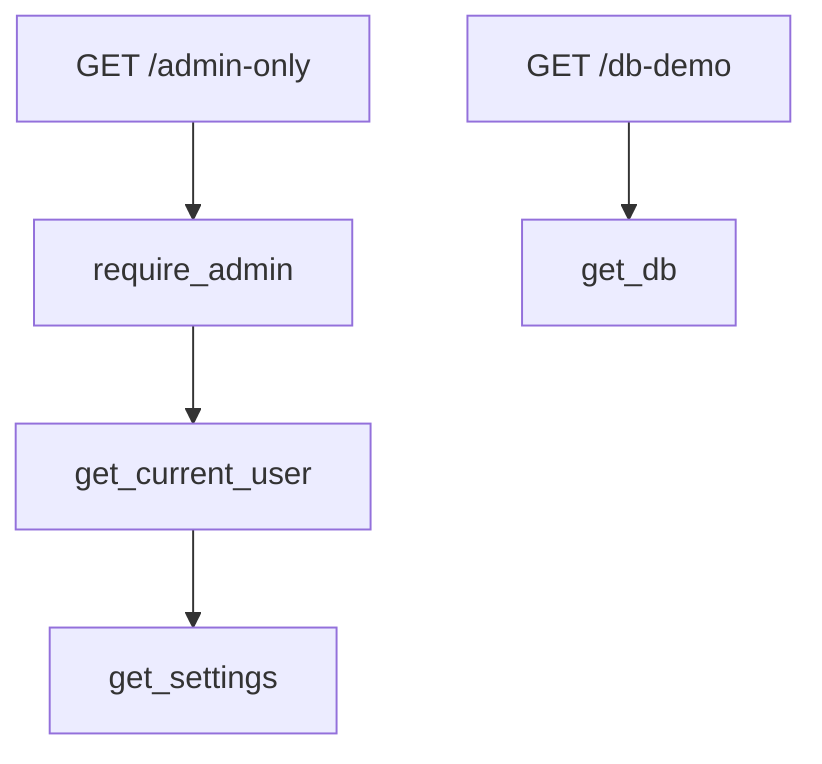

# Chapter 5 — Dependency Injection

## Concept

`Depends()` lets a route function declare "here's what I need to run" and have FastAPI supply it,
instead of the function reaching out and constructing its own dependencies.

## Why it exists

Without DI, every route that needs a DB session, the current user, or app settings has to import and
call the concrete implementation directly. That works until you need to test the route without a real
database, or without a real JWT — at which point you either monkeypatch imports (fragile) or refactor
to DI anyway. FastAPI bakes DI in from the start so you never have to make that choice under pressure.

## Mental model

A dependency is just a callable (function or class). FastAPI calls it, and whatever it `return`s or
`yield`s becomes the parameter's value. Dependencies can themselves take `Depends(...)` parameters —
FastAPI resolves the whole graph, computing each *unique* dependency once per request even if several
things need it.

## Diagram — the dependency graph in this chapter



`get_settings` is decorated with `@lru_cache`, so it behaves like a singleton: computed once per
process, shared across every request that needs it. `get_db` deliberately is **not** cached — every
request must get its own DB session, and it must be closed when the request ends (the `try/finally`
around `yield` in `app/db.py` guarantees this even if the route raises).

## Minimal example

```python
def get_settings():
    return Settings()

@app.get("/config")
def config(settings: Settings = Depends(get_settings)):
    return {"debug": settings.debug}
```

## Realistic example

`app/auth.py` builds a real nested chain: `require_admin` depends on `get_current_user`, which depends
on `get_settings`. Run it:

```bash
cd chapter5
PYTHONPATH=. uvicorn app.main:app --reload --port 8000
curl -H 'Authorization: Bearer token-alice' localhost:8000/admin-only   # Alice is admin -> 200
curl -H 'Authorization: Bearer token-bob'   localhost:8000/admin-only   # Bob is not     -> 403
curl localhost:8000/admin-only                                          # no token       -> 401
```

## Testing dependencies — the actual payoff

```python
app.dependency_overrides[get_current_user] = lambda: {"id": 99, "name": "Test", "role": "admin"}
```

`app/tests/test_di.py` shows this directly: a test can replace `get_current_user` with a fake user with
zero JWT machinery involved. This is *the* reason DI matters in practice — not elegance, testability.
Run: `PYTHONPATH=. pytest app/tests -v`.

## Common mistakes

- Caching a per-request dependency (like a DB session) with `@lru_cache` — every request would share
  the same session, causing subtle cross-request data bugs and eventually a session used after another
  request already closed it.
- Forgetting to clear `app.dependency_overrides` after a test — it leaks into subsequent tests in the
  same process (see the `try/finally` in `test_dependency_override_for_testing`).
- Doing expensive work (a DB query, an HTTP call) inside a dependency that's used on *every* route,
  without realizing it now runs on every single request.

## Production considerations

- `@lru_cache` on a settings dependency means environment variables are read once, at first use, not
  per-request. If you need runtime-reloadable config, this pattern is wrong — you'd need explicit reload
  logic.
- Nested auth dependencies (`require_admin` → `get_current_user`) compose cleanly, but each layer you
  add is a bit more per-request latency (a JWT decode, a role check). For extremely hot paths, measure
  it; for a normal CRUD API, it's noise.

## Exercise

Add a `require_role(role: str)` **dependency factory** — a function that returns a dependency, so you
can write `Depends(require_role("manager"))`. This is a different pattern than `require_admin`
(hardcoded to one role): parameterized dependencies unlock reusable, configurable checks.

## Interview-style scenario

> "Two different dependencies in the same request both depend on `get_settings`. Does FastAPI call
> `get_settings()` twice? What if `get_settings` weren't cached, and just returned a fresh `Settings()`
> instance each call — would anything actually break, or is caching purely a performance optimization
> here?"
