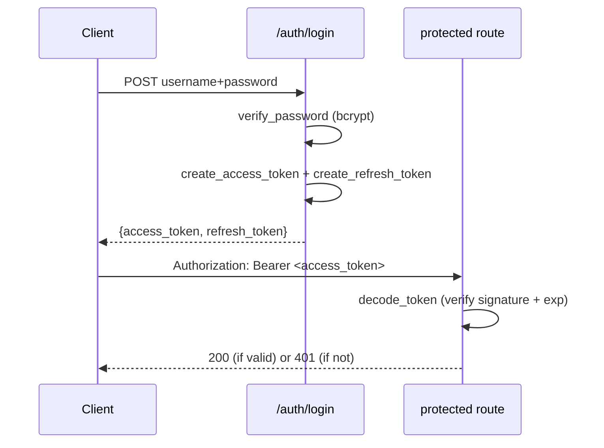

# Chapter 6 — JWT Authentication

## Concept

**Authentication** answers "who are you?" **Authorization** (next chapter) answers "what are you
allowed to do?" This chapter builds password-based login issuing JWTs, from scratch, so every step is
visible.

## Why it exists

Sessions (a server-side session ID in a cookie) require the server to look up session state on every
request. JWTs move that state into the token itself, signed so it can't be tampered with, so any server
holding the shared secret can verify a token without a shared session store — useful when you have
multiple stateless API instances behind a load balancer.

## Mental model

```
Client sends credentials once → server verifies → server signs a JWT → client stores it
→ client sends it on every request → server verifies the SIGNATURE (not a database lookup)
```

The token is like a wax-sealed letter: anyone can read what's inside (JWTs are base64, **not
encrypted**), but only someone holding the secret key could have produced a valid seal. Verification
means checking the seal, not looking anything up.

## Diagram



## JWT structure

```
header.payload.signature
{"alg":"HS256","typ":"JWT"}.{"sub":"ada@example.com","exp":...,"type":"access","jti":"..."}.<HMAC>
```

`header` and `payload` are just base64 — **decode a JWT at jwt.io and you can read the payload without
any secret**. The `signature` is the only part that prevents *tampering*; it doesn't provide
*confidentiality*. Never put secrets (passwords, card numbers) in a JWT payload.

## Access tokens vs refresh tokens

- **Access token**: short-lived (this chapter: 15 min), sent on every request, stateless verification.
- **Refresh token**: long-lived (7 days), sent only to `/auth/refresh` to get a new access token.
  Short access-token life limits the damage window if one leaks; the refresh token lets the user stay
  logged in without re-entering a password every 15 minutes.

`app/main.py`'s `/auth/refresh` **rotates** the refresh token: each use invalidates the old one and
issues a new one (see `VALID_REFRESH_TOKENS` allowlist in `app/store.py`). This is what lets you detect
refresh-token theft — if a stolen token is used before the legitimate owner's next refresh, the
allowlist entry point is where you'd add "if this rotated-away token is presented again, revoke the
whole token family" reuse-detection logic.

## Password hashing

```python
pwd_context = CryptContext(schemes=["bcrypt"], deprecated="auto")
hashed = pwd_context.hash(password)          # store this, never the plaintext
pwd_context.verify(plain, hashed)            # True/False on login
```

bcrypt is deliberately slow (a tunable "cost factor") — this is a feature: it makes brute-forcing a
stolen hash database expensive, at the cost of a few milliseconds per legitimate login.

## Where should tokens be stored? Cookies vs localStorage

| | httpOnly cookie | localStorage |
|---|---|---|
| Vulnerable to XSS reading the token | No (JS can't read httpOnly cookies) | Yes |
| Vulnerable to CSRF | Yes (browser auto-sends cookies) | No (JS must explicitly attach the header) |
| Needs CSRF token/SameSite config | Yes | No |

There is no universally "correct" answer — httpOnly cookies trade an XSS problem for a CSRF problem you
must then solve (`SameSite=Strict/Lax`, CSRF tokens on state-changing requests). This course does not
present JWT (or either storage mechanism) as automatically superior — each choice has a real trade-off.

## Token revocation

JWTs are stateless *by design*, which means "logout" doesn't naturally exist — a still-valid,
unexpired token remains valid until it expires, even after "logout," unless you track it somewhere.
`app/store.py`'s `VALID_REFRESH_TOKENS` set is exactly this tracking, applied only to refresh tokens
(access tokens are short-lived enough that most systems accept the small revocation window as a
trade-off for staying stateless on the hot path).

## Common mistakes

- Treating JWT payload contents as private — they are base64, not encrypted. Anyone with the token can
  read `sub`, `exp`, and any custom claims.
- No token expiration, or an access token with a multi-day expiry — turns a single leaked token into a
  long-lived skeleton key.
- Storing the JWT secret in source code (this chapter does, on a single clearly-marked line, for
  learning purposes only — in production it comes from a secrets manager / environment variable).
- Not checking `type` (`access` vs `refresh`) when decoding — without it, a refresh token could be
  replayed as an access token to a protected route.

## Production considerations

- Rotate the signing secret periodically; support verifying against the previous secret during a grace
  period so in-flight tokens don't all break at once.
- Consider asymmetric signing (RS256) if multiple services need to *verify* tokens but only one service
  should be able to *issue* them — the private key stays with the issuer, public key is distributed.
- Rate-limit `/auth/login` (chapter 10) — it's the highest-value brute-force target in your whole API.

## Exercise

Add password reset: `POST /auth/forgot-password` issues a short-lived, single-use token (a `type:
"reset"` JWT works, or a random token stored server-side); `POST /auth/reset-password` consumes it and
updates the password hash. Make sure a reset token can't be reused as an access token.

## Interview-style scenario

> "A user reports their account was accessed from a country they've never visited, hours after they
> changed their password. Walk through why a JWT-based system might still let the old session through,
> and what you'd add to prevent it."

(Expected direction: access tokens issued before the password change remain valid until they expire
unless you track a "tokens issued before this timestamp are invalid" marker per user, or move to
short-enough access-token lifetimes that this window is negligible.)
