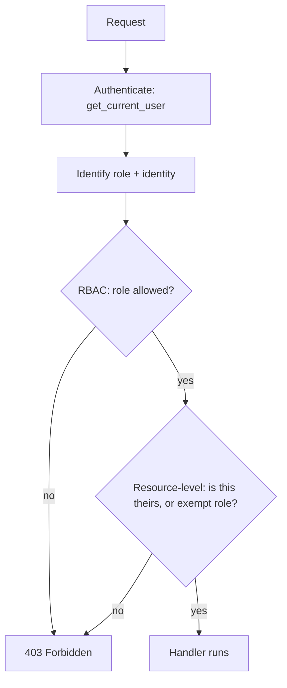

# Chapter 7 — Authorization (RBAC)

## Concept

**Authentication** = who are you. **Authorization** = what are you allowed to do. This chapter builds
Role-Based Access Control (RBAC) — permissions attached to roles (`user`, `manager`, `admin`) — plus a
taste of resource-level (ownership-based, ABAC-flavored) authorization, which RBAC alone can't express.

## Why it exists

Once you have more than one type of user, "logged in" stops being a sufficient check. An admin
deleting any user and a regular user reading their own profile are both "authenticated" requests — the
difference is authorization.

## Mental model

RBAC answers: **"does this role have this permission?"** — a lookup, no context about the specific
resource involved. Resource-level authorization answers: **"does this specific request's context (e.g.
resource ownership) permit this action?"** — you need the resource, not just the role, to decide.

## Diagram



## Realistic example

`app/deps.py`'s `require_role(*allowed)` is a **dependency factory**: it returns a dependency
pre-configured for a set of roles, so routes declare `Depends(require_role(Role.admin))` instead of
duplicating the same `if user.role != "admin": raise ...` in every handler.

`app/main.py` has three authorization shapes side by side:
- `read_own_profile` — resource-level: your own profile, OR a manager/admin can read anyone's.
- `read_team_data` — pure RBAC: manager or admin, no ownership dimension.
- `delete_user` — pure RBAC: admin only.

```bash
cd chapter7
PYTHONPATH=. uvicorn app.main:app --reload --port 8000
curl -H 'X-User-Email: carol@example.com' localhost:8000/profiles/carol@example.com   # 200 (own)
curl -H 'X-User-Email: carol@example.com' localhost:8000/profiles/dave@example.com    # 403 (not own, not manager)
curl -H 'X-User-Email: bob@example.com'   localhost:8000/team-data                    # 200 (manager)
```

(This chapter simulates identity via an `X-User-Email` header to isolate authorization from
authentication mechanics — see chapter 6 for real JWT-based `get_current_user`. In a real app,
`get_current_user` here would decode a JWT exactly like chapter 6's version.)

## Common mistakes

- Checking role but not ownership on a "read your own X" endpoint — the classic **Insecure Direct
  Object Reference (IDOR)**: `GET /profiles/{email}` with no check lets any logged-in user read anyone's
  profile by just changing the URL.
- Doing authorization checks in the database query's `WHERE` clause only, with no explicit check in
  code — easy to accidentally construct a query that skips it in one code path but not another.
- Returning 404 for both "doesn't exist" and "exists but you can't see it" inconsistently across
  endpoints — pick one policy (some APIs deliberately return 404 instead of 403 to avoid confirming a
  resource exists to someone unauthorized; know that you're choosing this trade-off).

## Production considerations

- RBAC gets unwieldy once you need finer permissions ("manager of team X, but not team Y") — that's
  when teams introduce **ABAC** (attribute-based) or a permissions table (`user_id, resource, action`)
  instead of a fixed role enum.
- Centralize authorization logic in dependencies (as this chapter does), not scattered `if` statements
  in route bodies — the day you need an audit of "everywhere we check for admin," a scattered
  implementation makes that audit expensive.

## Exercise

Add a `PATCH /profiles/{email}` endpoint: a user can edit their own bio; a manager can edit any
teammate's bio; an admin can edit anyone's. Write this as composed dependency logic, not one giant `if`.

## Interview-style scenario

> "Your `GET /invoices/{id}` endpoint checks the caller's role is at least `accountant` but not whether
> the invoice belongs to the caller's own company. Six months later, a customer support employee at
> Company A calls it with an ID belonging to Company B and sees financial data that isn't theirs. What
> class of bug is this, and where should the fix live — the route, the service, or the query itself?"
