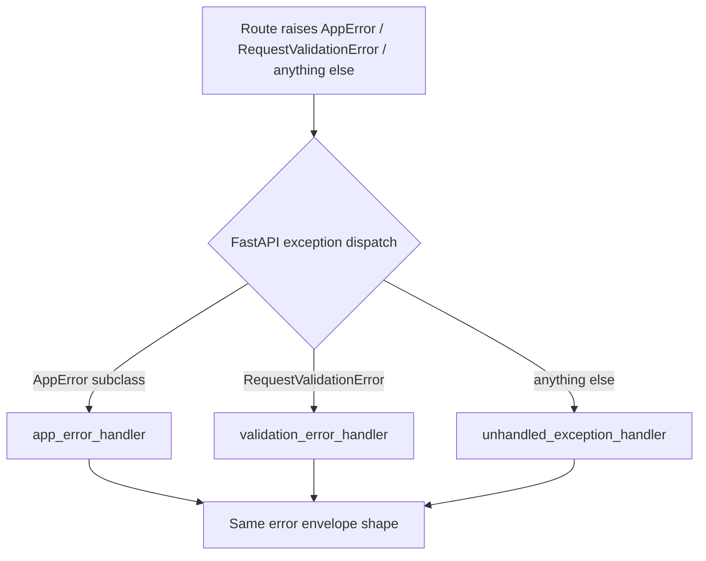

# Chapter 9 — Error Handling

## Concept

Global exception handlers convert every kind of failure — your own domain exceptions, Pydantic
validation errors, and truly unexpected bugs — into one consistent JSON error shape.

## Why it exists

Without this, every route ends up with its own ad hoc `try/except` and its own error JSON shape. A
frontend then needs a different error-parsing branch per endpoint. Centralizing it means the frontend
writes exactly one error handler, ever.

## Mental model

**Routes raise. Handlers translate.** A route should never construct a `JSONResponse` for an error case
itself — it raises a meaningful exception (`NotFoundError(...)`) and lets a registered
`@app.exception_handler` decide the HTTP status and body shape.

## Diagram



## Realistic example

`app/errors.py` defines a small exception hierarchy (`NotFoundError`, `OutOfStockError`, `ConflictError`
...) each carrying its own `status_code` and `code`. `app/main.py` registers three handlers:

1. `app_error_handler` — catches every `AppError` subclass, one handler for the whole hierarchy.
2. `validation_error_handler` — overrides FastAPI's default 422 body to match our envelope.
3. `unhandled_exception_handler` — a catch-all safety net for genuine bugs.

```bash
cd chapter9
PYTHONPATH=. uvicorn app.main:app --reload --port 8000
curl -i localhost:8000/products/999                                  # 404, our envelope
curl -i -X POST "localhost:8000/orders?product_id=1&quantity=1"      # 400 OUT_OF_STOCK
curl -i "localhost:8000/orders?product_id=nope&quantity=1"           # 422 VALIDATION_ERROR
curl -i localhost:8000/boom                                          # 500, generic message, no traceback
```

## What information should NOT be exposed to clients

`unhandled_exception_handler` logs the **full** exception (`logger.exception(...)`) server-side but
returns only `"An unexpected error occurred"` plus a request ID to the client. Never send:
- Stack traces (reveal file paths, library versions, sometimes source code)
- Raw database error messages (can reveal schema/table names, sometimes query fragments)
- Internal service names/URLs in a microservices setup

The request ID is what lets a client report "error `8f14e45f...`" to support, and lets you `grep` your
logs for the full traceback without ever exposing it over the wire.

## Common mistakes

- Catching `Exception` broadly inside a route and returning `{"error": str(e)}` — this leaks whatever
  the underlying library's exception message contains, inconsistently, per route.
- Forgetting to override FastAPI's default validation error format — now your custom errors and
  Pydantic's built-in ones have two different JSON shapes, defeating the whole point.
- Logging at `error` level for expected, client-caused errors (404, 400) — reserve alerting-worthy log
  levels for genuine 500s; a 404 for a missing product is normal traffic, not an incident.

## Production considerations

- Feed the request ID through to your APM/log aggregator so a support ticket referencing an ID resolves
  to the exact log lines and, ideally, the exact trace (chapter 22).
- Consider whether 4xx errors should be logged at all in high-volume APIs — logging every 404 at
  info/debug is usually fine, but don't let it drown out real signal.

## Exercise

Add a `RateLimitedError` (429) to the hierarchy and a route that raises it. Then add a `retry_after`
field to the error envelope, but *only* for this specific error type — figure out how to extend the
envelope per-error-type without breaking the shared `error_envelope()` helper's contract for everyone else.

## Interview-style scenario

> "A client team says your API 'sometimes returns HTML instead of JSON on errors.' What FastAPI/Starlette
> behavior would cause that, and where would you look first?"

(Expected direction: an exception raised *before* your custom handlers even run — e.g. inside another
middleware, or a routing-level 404 for a URL that doesn't match any route at all — can bypass your
`@app.exception_handler` registrations and fall through to a default HTML error page from the ASGI
server itself.)
